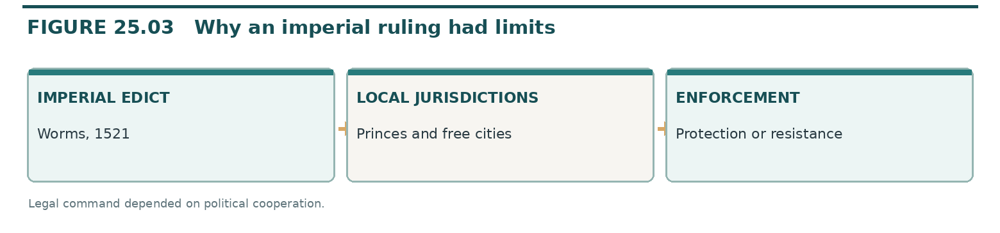

By 1519, Luther's disputes with theologians such as Johann Eck raised fundamental questions about the authority of popes, councils and scripture. In 1520 he published influential reform writings that attacked established ecclesiastical structures and offered revised accounts of Christian freedom and the sacraments. Pope Leo X's bull Exsurge Domine threatened action against propositions attributed to Luther; Luther publicly rejected papal condemnation. In 1521 he was excommunicated. At the Diet of Worms, an imperial assembly, he refused to retract writings unless persuaded by scripture or compelling reason, although famous dramatic speeches associated with this scene have uncertain wording.

Emperor Charles V confronted a problem that was not purely religious. His dominions stretched across Europe and overseas, and he faced rival powers, including France and the Ottoman Empire. German princes guarded territorial privileges within the Holy Roman Empire, a complex collection of principalities, ecclesiastical territories and cities. Frederick the Wise of Saxony protected Luther after Worms, enabling him to shelter at Wartburg Castle. Imperial condemnation did not translate automatically into enforcement across every town and estate.

This was the collision of two scales of government. Universal religious claims were defended by institutions that depended on territorial cooperation. A ruler's edict might be authoritative on paper and unenforceable where local magistrates, princes or communities resisted. Studying the Diet of Worms alongside imperial political geography explains more than presenting Luther as a solitary hero who defeated a united continent. He was courageous in defending his beliefs; his survival also depended on states, alliances and institutional limits. \[<a href="/025-reformation-and-religious-conflict/sources/#source-1" class="cite">1</a>\]\[<a href="/025-reformation-and-religious-conflict/sources/#source-6" class="cite">6</a>\]\[<a href="/025-reformation-and-religious-conflict/sources/#source-7" class="cite">7</a>\]

<figure class="figure" id="figure-25-3">

<figcaption>Figure 25.3. Legal command depended on political cooperation. <a class="figure-anchor" href="#figure-25-3" aria-label="Link to this figure">#</a></figcaption>
</figure>
