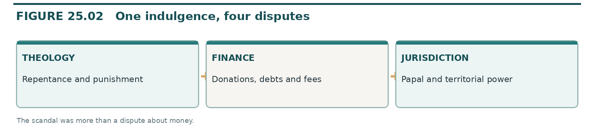

A particular indulgence campaign brought these tensions into focus. In the Holy Roman Empire, Albrecht of Brandenburg held important ecclesiastical offices, while fundraising connected with the rebuilding of St Peter's in Rome created pressures for revenue. The Dominican preacher Johann Tetzel became associated with indulgence promotion in territories near Wittenberg. Financial arrangements were complex and benefited more than one institution; portraying them simply as one man selling heaven to gullible customers conceals the machinery of appointments, debts, permissions and preaching.

The controversy was explosive because it crossed several boundaries at once. At the theological level, who could determine how repentance and punishment related? At the pastoral level, were believers being given false reassurance? At the economic level, where would collected funds go? At the political level, could a papal program operate across the territorial interests of princes? These layers did not always produce the same alliances. A prince might dislike financial outflows to Rome while maintaining traditional worship; a professor might attack careless preaching without intending to create a new church.

The broader lesson is that a contested practice can become a symbol for a much larger argument. Once critics connected indulgences to the credibility of papal authority, answering their theological objections became harder without discussing institutions and power. Yet historians should not confuse what a reformer later came to believe with what he had already decided in 1517. Luther's early dispute was not yet a full blueprint for a separate Protestant denomination. \[<a href="/025-reformation-and-religious-conflict/sources/#source-4" class="cite">4</a>\]\[<a href="/025-reformation-and-religious-conflict/sources/#source-5" class="cite">5</a>\]\[<a href="/025-reformation-and-religious-conflict/sources/#source-6" class="cite">6</a>\]

<figure class="figure" id="figure-25-2">

<figcaption>Figure 25.2. The scandal was more than a dispute about money. <a class="figure-anchor" href="#figure-25-2" aria-label="Link to this figure">#</a></figcaption>
</figure>
