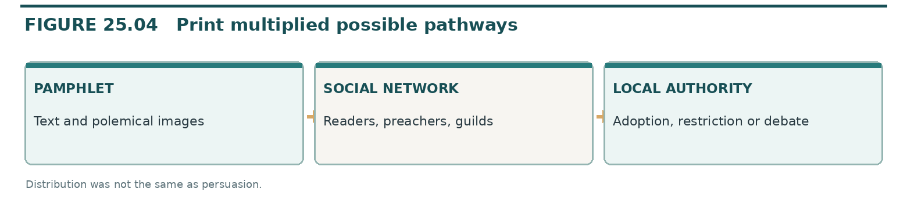

The early Reformation was a media event, but that does not mean every household owned a Bible or could read. Printers produced pamphlets, vernacular sermons, songbooks, catechisms and polemical images. Public readings and preaching brought texts to people who encountered them collectively. Woodcuts depicted reformers, popes, priests and opposing religious claims in readily recognizable forms, sometimes using mockery and frightening stereotypes. Music carried arguments into congregations; texts spread through merchants, students and travelers.

These networks also created selection effects. The best-preserved printed works may tell us more about urban publishing markets than about what remote villages thought. A widely printed tract proves availability, not agreement. The number of editions is evidence of commercial and political attention, not a direct opinion poll. Authorities on different sides issued censorship orders and seized publications, while printers adjusted to local patronage, danger and profit. The same technology enabled Catholic catechisms and anti-Protestant replies.

Imagine three towns receiving an identical pamphlet. In one, a sympathetic council sponsors a sermon; in the second, authorities ban discussion; in the third, merchants read the pamphlet but remain cautious about changing worship. The identical printed text has three different institutional outcomes. Media spread possibilities, not automatic consequences. This distinction will return in later chapters about newspapers, propaganda and modern social platforms. \[<a href="/025-reformation-and-religious-conflict/sources/#source-1" class="cite">1</a>\]\[<a href="/025-reformation-and-religious-conflict/sources/#source-4" class="cite">4</a>\]\[<a href="/025-reformation-and-religious-conflict/sources/#source-8" class="cite">8</a>\]

<figure class="figure" id="figure-25-4">

<figcaption>Figure 25.4. Distribution was not the same as persuasion. <a class="figure-anchor" href="#figure-25-4" aria-label="Link to this figure">#</a></figcaption>
</figure>
