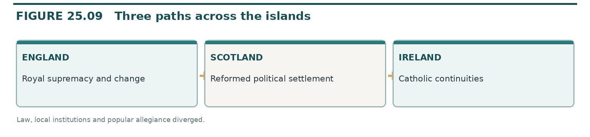

In Scotland, religious reform drew on international networks, local noble politics and the preaching associated with John Knox. The Scottish Reformation Parliament of 1560 helped establish a Protestant settlement, though relations among crown, church and parliament remained unsettled. Reformed theology influenced the organization of the kirk, including later Presbyterian traditions. Scottish developments were linked to struggles over Mary, Queen of Scots, relations with England and France, and the balance between aristocratic factions and royal power.

Ireland presents a different history. English rule was uneven, and attempts to establish a Protestant church generally did not win the allegiance of the great majority of Irish-speaking people, who continued Catholic practice. Land ownership, political loyalty, language and conquest became intertwined with confessional identity. Later plantations and coercive state policies intensified those divisions. We should not assume an English legal settlement automatically determined religious life across the islands. Local priests, families, institutions and cross-border contacts often mattered more than decrees issued in London.

These contrasts reveal an important historical distinction: a ruler can establish a legal church without converting a population. Enduring confessional identities emerge from generation after generation of institutions, social pressure, community memory and political events. Nor did 'Protestant' or 'Catholic' correspond to an unchanging national personality. Confessional affiliation could intersect with political allegiance while evolving through conflict and compromise. \[<a href="/025-reformation-and-religious-conflict/sources/#source-2" class="cite">2</a>\]\[<a href="/025-reformation-and-religious-conflict/sources/#source-14" class="cite">14</a>\]

<figure class="figure" id="figure-25-9">

<figcaption>Figure 25.9. Law, local institutions and popular allegiance diverged. <a class="figure-anchor" href="#figure-25-9" aria-label="Link to this figure">#</a></figcaption>
</figure>
