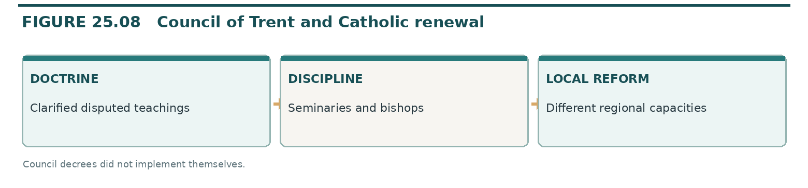

The Council of Trent met in three major periods between 1545 and 1563, interrupted by war, disease, politics and disagreements about church authority. Its participants were Catholic prelates and theologians, not a meeting where Protestant and Catholic delegates negotiated a shared compromise. The council clarified disputed doctrines, including scripture and tradition, justification and the sacraments, and reaffirmed central features of Catholic worship. It also adopted disciplinary reforms addressing clergy education, pastoral oversight and episcopal responsibilities.

It is misleading to describe Trent as simply banning change. The council preserved doctrines central to Catholic identity while creating frameworks for institutional change. Seminaries became important for training priests, though implementation differed among dioceses. Liturgical books and catechisms issued or revised in the following years helped standardize aspects of worship. The council's decisions did not instantaneously erase older practices or produce identical Catholic communities from Lisbon to Kraków. Local politics, funding and pastoral habits continued to matter.

Trent also shows why theological disagreement could harden into durable institutional separation. Catholic and Protestant leaders increasingly explained their traditions in more precise terms. This intellectual clarity could strengthen education and internal coherence while making compromise harder. In retrospect, historians debate whether 'confessionalization' describes a coordinated system of state and church discipline or exaggerates what early modern governments could actually control. The documentary record supports both a drive toward greater regulation and substantial gaps between official prescription and ordinary life. \[<a href="/025-reformation-and-religious-conflict/sources/#source-17" class="cite">17</a>\]\[<a href="/025-reformation-and-religious-conflict/sources/#source-18" class="cite">18</a>\]

<figure class="figure" id="figure-25-8">

<figcaption>Figure 25.8. Council decrees did not implement themselves. <a class="figure-anchor" href="#figure-25-8" aria-label="Link to this figure">#</a></figcaption>
</figure>
