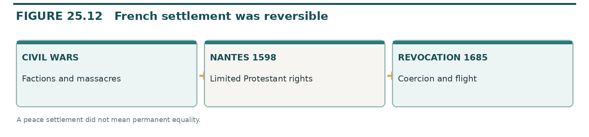

In France, Reformed Protestants known as Huguenots gained adherents among some nobles, townspeople and other groups. Tensions became intertwined with the authority of the monarchy, aristocratic factions, local rivalries and fears about the kingdom's future. A series of civil wars began in 1562, but the conflicts did not follow a simple pattern of two fixed armies fighting continuously. Courts negotiated truces, religious parties split, and local violence could continue even after an official settlement.

The Saint Bartholomew's Day massacres beginning in Paris in August 1572, followed by violence in several provincial towns, killed thousands of Protestants. The number remains debated and differs among estimates; historians investigate the interaction of royal decisions, factional politics, popular hostility and events that escalated beyond initial plans. This was not merely a regrettable misunderstanding between abstract doctrines. People were attacked and killed because religious identity had become a marker of collective threat in a volatile political setting.

Henry of Navarre, eventually Henry IV of France, converted to Catholicism and secured his kingship amid conflict. His Edict of Nantes in 1598 granted important, defined rights and protections to French Protestants while preserving Catholicism's privileged position; it did not create modern universal equality. In 1685 Louis XIV revoked the edict, triggering renewed repression and Protestant flight. The episode shows why one peace agreement does not guarantee permanent toleration. Legal settlements depend on political institutions and the willingness of later rulers to maintain them. \[<a href="/025-reformation-and-religious-conflict/sources/#source-24" class="cite">24</a>\]\[<a href="/025-reformation-and-religious-conflict/sources/#source-25" class="cite">25</a>\]

<figure class="figure" id="figure-25-12">

<figcaption>Figure 25.12. A peace settlement did not mean permanent equality. <a class="figure-anchor" href="#figure-25-12" aria-label="Link to this figure">#</a></figcaption>
</figure>
