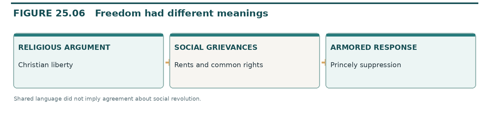

In 1524–25, uprisings across parts of the German-speaking lands brought together peasants and some townspeople demanding changes to dues, access to common resources, justice and local power. The Twelve Articles, associated with insurgents in Upper Swabia, appealed to scripture and claims of fairness. Grievances were neither identical everywhere nor created exclusively by Luther's preaching. Long disputes over lordship, rents and customary rights supplied the immediate setting. Yet a religious language of Christian freedom gave some demands additional force.

Luther initially urged attention to grievances but sharply condemned armed revolt, especially as violence spread. His writings against rebellious peasants encouraged authorities to suppress the insurrection, and princely forces killed many people. Estimates of deaths vary because contemporary counts were uneven, but the defeat was devastating. Other religious leaders adopted different positions. Thomas Müntzer became associated with radical arguments and a willingness to challenge established rulers; his role should not be simplified into a modern secular revolution disguised as religion.

The peasants' experience exposes the gap between a powerful religious metaphor and a program of social reform. Freedom of a Christian could mean liberation from the burden of earning salvation, but people living under seigneurial authority might hear a wider promise. Reform leaders did not agree that theological freedom justified overturning social hierarchies. Was the uprising caused by the Reformation? An evidence-based answer distinguishes its long-standing economic and political causes from the new language, alliances and expectations that shaped events. Religious movements can generate meanings that their original leaders cannot control. \[<a href="/025-reformation-and-religious-conflict/sources/#source-1" class="cite">1</a>\]\[<a href="/025-reformation-and-religious-conflict/sources/#source-2" class="cite">2</a>\]\[<a href="/025-reformation-and-religious-conflict/sources/#source-3" class="cite">3</a>\]

<figure class="figure" id="figure-25-6">

<figcaption>Figure 25.6. Shared language did not imply agreement about social revolution. <a class="figure-anchor" href="#figure-25-6" aria-label="Link to this figure">#</a></figcaption>
</figure>
