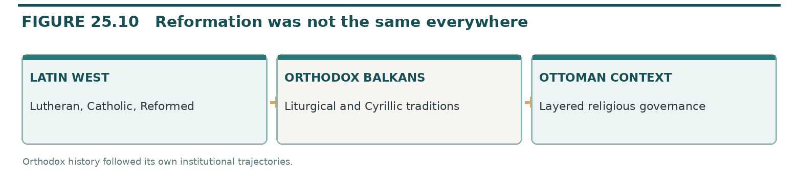

The Protestant Reformation largely unfolded within Latin Christianity. Most Orthodox communities in the Balkans experienced it from a different political and theological setting. After the Ottoman conquests, Orthodox religious institutions continued under Muslim imperial rule, but their positions, privileges and fiscal obligations changed through negotiation, conflict and local practice. Scholars caution against describing the fifteenth- and sixteenth-century empire as if a fully fixed nineteenth-century-style millet system already existed everywhere. The Ecumenical Patriarchate, regional churches, monasteries and local lay leaders did not all possess the same authority.

For Bulgarian lands, the story is therefore not a simple sequence of Lutheran doctrines displacing Orthodox Christianity. Monasteries and clergy preserved liturgical and manuscript traditions, while Orthodox Slavic texts circulated through printing centers outside and within Ottoman jurisdictions. Early Cyrillic and Serbian-language printing in the region, including presses associated with Cetinje and other Orthodox centers, demonstrates that technological diffusion did not require doctrinal alignment with Wittenberg. Printing served Orthodox liturgy, learning and identity as well as Western confessional debate.

The Ottoman Empire also shaped European geopolitical calculations. Charles V, the Habsburgs and other powers faced Ottoman campaigns, while religiously divided Christian rulers sometimes coordinated against them and at other times competed despite an external threat. Orthodox communities should not appear as passive bystanders or as early modern 'Protestants in disguise.' Their religious history followed its own arguments, institutions, encounters and constraints. This larger perspective corrects an otherwise Western-European definition of the sixteenth century. \[<a href="/025-reformation-and-religious-conflict/sources/#source-28" class="cite">28</a>\]\[<a href="/025-reformation-and-religious-conflict/sources/#source-29" class="cite">29</a>\]

<figure class="figure" id="figure-25-10">

<figcaption>Figure 25.10. Orthodox history followed its own institutional trajectories. <a class="figure-anchor" href="#figure-25-10" aria-label="Link to this figure">#</a></figcaption>
</figure>
