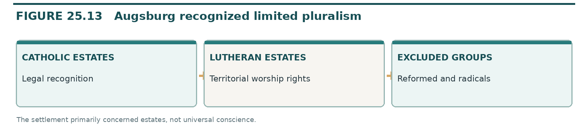

Within the Holy Roman Empire, Protestant princes and cities formed the Schmalkaldic League to protect their interests. Charles V eventually defeated the league militarily in 1547, yet victory did not secure a permanent restoration of Catholic unity. Renewed alliances and warfare constrained imperial power. The Religious Peace of Augsburg, agreed in 1555, recognized a legal coexistence of Catholic and Lutheran territorial arrangements within the empire under specified conditions.

The familiar shorthand cuius regio, eius religio—'whose rule, his religion'—is a later formula rather than a complete quotation from the original agreement. It captures the principle that many imperial estates could regulate official religion in their territories, but it conceals exceptions, rights of emigration, special arrangements in some cities and the exclusion of Reformed/Calvinist and Anabaptist communities from full recognition. Augsburg was not a charter for individuals to believe and worship as they pleased. It was a political settlement among authorized rulers and estates intended to reduce conflict.

The agreement was nevertheless important because it accepted a legally structured religious division that earlier authorities had struggled to acknowledge. It did not eliminate the need for negotiations over church property or jurisdiction, and later disputes exposed its limitations. A comparison with modern freedom of religion should start by asking who held legal authority. Augsburg largely protected political estates and certain defined communities; modern rights frameworks generally recognize individuals as rights holders. Historical institutions should be assessed on their own terms before claims of continuity are made. \[<a href="/025-reformation-and-religious-conflict/sources/#source-20" class="cite">20</a>\]\[<a href="/025-reformation-and-religious-conflict/sources/#source-1" class="cite">1</a>\]

<figure class="figure" id="figure-25-13">

<figcaption>Figure 25.13. The settlement primarily concerned estates, not universal conscience. <a class="figure-anchor" href="#figure-25-13" aria-label="Link to this figure">#</a></figcaption>
</figure>
