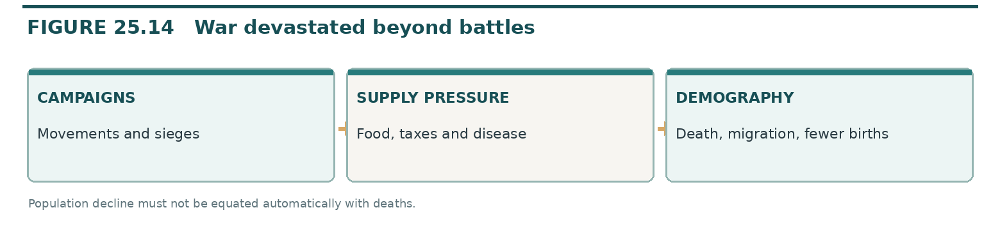

In 1618, tensions over religious rights and political authority in Bohemia helped trigger a revolt against Habsburg rule. The Prague defenestration became a memorable symbol, but the war cannot be explained by a single dramatic act. The Bohemian rebellion and its defeat were followed by a wider series of conflicts involving imperial estates, the Habsburgs, Denmark, Sweden, France, Spain and others. Religious commitments were real, yet alliances increasingly reflected fears of dynastic and geopolitical domination.

Historians commonly divide the war into phases—Bohemian-Palatine, Danish, Swedish and French-Swedish—because the belligerents and strategic aims changed. Such labels are teaching aids, not watertight compartments. Gustavus Adolphus of Sweden intervened in 1630; after his death at Lützen in 1632 the war continued. Catholic France's direct war against the Habsburg powers from 1635 is a clear warning against describing the conflict as a simple Catholic army versus Protestant army. The logic of great-power rivalry could cross confessional lines.

Fighting involved battles, sieges, forced contributions, movement of troops, devastation of crops and repeated displacement. Armies depended on supply systems that placed extraordinary burdens on local populations. Some regions suffered far more than others. To understand why warfare persisted, we must examine military finance, alliances, the insecurity of territories and repeated failures to negotiate acceptable settlements. Religion remained part of the conflict, but it was not the only engine keeping European armies in the field. \[<a href="/025-reformation-and-religious-conflict/sources/#source-21" class="cite">21</a>\]\[<a href="/025-reformation-and-religious-conflict/sources/#source-22" class="cite">22</a>\]

<figure class="figure" id="figure-25-14">

<figcaption>Figure 25.14. Population decline must not be equated automatically with deaths. <a class="figure-anchor" href="#figure-25-14" aria-label="Link to this figure">#</a></figcaption>
</figure>
