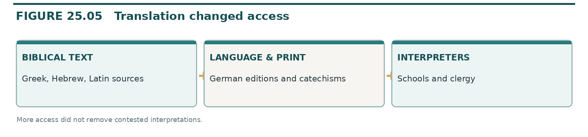

While sheltered at Wartburg, Luther translated the New Testament into German; it appeared in 1522. A complete German Bible associated with Luther and collaborators followed in 1534. His work drew on existing German biblical language and scholarly traditions rather than inventing vernacular scripture. Translation decisions mattered because a word could influence doctrinal interpretation and because readers from different regions understood vocabulary differently. Standardization resulted from schooling, printing, administration and many writers, not from a single book magically creating a national language.

The new reading culture was uneven. Full Bibles were expensive; access depended on literacy, region, social standing and institutions. Churches, households and schools used shorter texts and catechisms to transmit doctrine. Ministers often interpreted biblical passages for listeners. Protestant leaders could simultaneously promote access to scripture and insist that unauthorized interpretations threatened social peace. The promise of personal engagement with sacred text coexisted with strict boundaries over who could preach and establish a congregation.

This tension illustrates a general principle: providing access to information does not eliminate disputes about expertise and authority. It can multiply them. Catholic scholars also translated, printed and studied the Bible. The emergence of rival textual communities made it more urgent to distinguish what the text said, what interpreters claimed it said, and which government or church body could enforce that interpretation. \[<a href="/025-reformation-and-religious-conflict/sources/#source-3" class="cite">3</a>\]\[<a href="/025-reformation-and-religious-conflict/sources/#source-7" class="cite">7</a>\]\[<a href="/025-reformation-and-religious-conflict/sources/#source-8" class="cite">8</a>\]

<figure class="figure" id="figure-25-5">

<figcaption>Figure 25.5. More access did not remove contested interpretations. <a class="figure-anchor" href="#figure-25-5" aria-label="Link to this figure">#</a></figcaption>
</figure>
