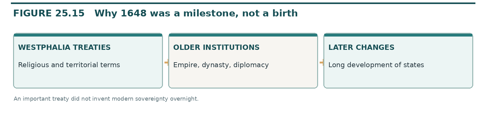

The treaties concluded at Münster and Osnabrück in 1648, commonly grouped under the Peace of Westphalia, helped end the Thirty Years' War in the Holy Roman Empire and rearranged aspects of European diplomacy. They confirmed and modified earlier religious arrangements, including recognition of the Reformed confession alongside Catholicism and Lutheranism within the imperial framework, and negotiated rights and protections under specified conditions. The treaties also addressed territory, legal jurisdiction and relations among imperial and foreign powers.

Westphalia is sometimes portrayed as the single birth certificate of the modern sovereign state system: supposedly before 1648 rulers obeyed a unified universal authority, and afterward every state possessed complete independence. That is historically misleading. Dynastic states, cities, kingdoms, empires and diplomatic norms had developed over centuries; after 1648 the Holy Roman Empire still possessed layered institutions and rulers still intervened across borders. The treaties mattered greatly without creating a world of modern nation-states overnight.

Why does the myth persist? It offers a clean turning point for teaching complex developments. Yet clean turning points can hide centuries of continuity and uneven change. A stronger account asks what specific clauses protected which actors, how later lawyers interpreted the agreements, and how the realities of power shaped what was enforced. Westphalia illustrates the book's recurring theme: an event may be a landmark without being the origin of everything later associated with it. \[<a href="/025-reformation-and-religious-conflict/sources/#source-20" class="cite">20</a>\]\[<a href="/025-reformation-and-religious-conflict/sources/#source-21" class="cite">21</a>\]

<figure class="figure" id="figure-25-15">

<figcaption>Figure 25.15. An important treaty did not invent modern sovereignty overnight. <a class="figure-anchor" href="#figure-25-15" aria-label="Link to this figure">#</a></figcaption>
</figure>
