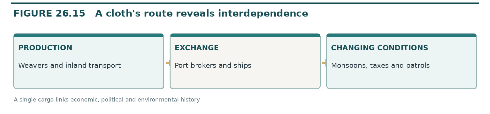

Imagine a hypothetical length of cotton cloth woven in western India in the early sixteenth century. An intermediary buys it from a producer and arranges transport toward the coast. A merchant finances its journey through a port where customs officers assess dues. The cloth is packed aboard a vessel whose captain relies on seasonal winds. At Melaka, a broker discovers that buyers prefer a certain pattern and offers a lower price than expected. The merchant decides whether to accept, store the cloth until another fleet arrives or trade it for a different commodity. This is a teaching case, not a reconstruction of a documented shipment.

What makes the cloth valuable? Its material quality, color and design matter, but so do the buyer's preferences, transport expenses, available substitutes, and the merchant's ability to wait. If it is exchanged for pepper, that pepper begins another series of transactions before reaching western consumers. The market is therefore connected without all participants sharing a language, government or detailed knowledge of the final buyer. The producer could be affected by a price change thousands of kilometers away without learning why it occurred.

Now add a Portuguese patrol requiring a pass, a port ruler changing customs dues and a storm delaying arrivals. Each alters expected profit without necessarily ending the trade. The case illustrates three general principles: goods travel through chains of intermediaries; political power can change incentives without wholly replacing markets; and one surviving document describes only a slice of the larger process. \[<a href="/026-indian-ocean-commerce-and-asian-powers/sources/#source-4" class="cite">4</a>\]\[<a href="/026-indian-ocean-commerce-and-asian-powers/sources/#source-8" class="cite">8</a>\]\[<a href="/026-indian-ocean-commerce-and-asian-powers/sources/#source-10" class="cite">10</a>\]

<figure class="figure" id="figure-26-15">

<figcaption>Figure 26.15. A single cargo links economic, political and environmental history. <a class="figure-anchor" href="#figure-26-15" aria-label="Link to this figure">#</a></figcaption>
</figure>
