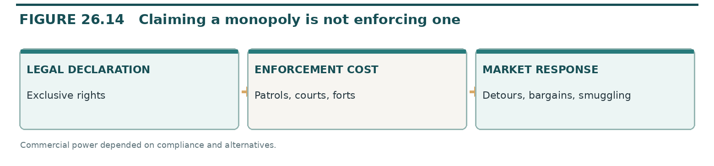

Histories of early modern empires often treat monopoly as a condition that follows immediately from a government's declaration. In practice, exclusive rights must be enforced. Officials must identify cargo, patrol routes, prevent evasion, secure compliance from local buyers and pay enough personnel to make that system credible. A ruler who controls one harbor can still face competing ports and hidden coastlines. Even forceful maritime states relied on brokers and suppliers who could bargain.

Portuguese attempts to control parts of the spice trade were consequential but incomplete. Armed seizures and passes changed risks and costs for many merchants, yet Asian merchants continued to carry enormous quantities of goods. Some joined Portuguese commercial arrangements because doing so was profitable or safer than resisting. Others evaded, negotiated or fought. A binary portrait of heroic resistance against absolute European control would miss this shifting range of choices.

The Indian Ocean world illustrates why economic power is relational. A ship with cannon may compel a vessel to stop; that does not make weavers produce more cloth or persuade all buyers to accept a price. Trade patterns rest on supply and demand, political protection, existing routes and the possibility of substitution. A network may be violently disrupted without becoming centrally administered. This distinction prepares us to understand the more extensive corporate and colonial projects of later centuries. \[<a href="/026-indian-ocean-commerce-and-asian-powers/sources/#source-2" class="cite">2</a>\]\[<a href="/026-indian-ocean-commerce-and-asian-powers/sources/#source-4" class="cite">4</a>\]\[<a href="/026-indian-ocean-commerce-and-asian-powers/sources/#source-27" class="cite">27</a>\]

<figure class="figure" id="figure-26-14">

<figcaption>Figure 26.14. Commercial power depended on compliance and alternatives. <a class="figure-anchor" href="#figure-26-14" aria-label="Link to this figure">#</a></figcaption>
</figure>
