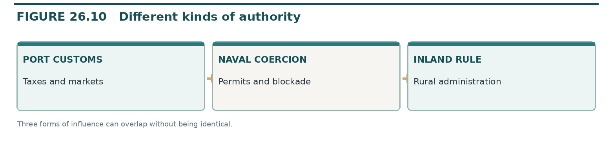

A merchant encountered several kinds of political power: rulers of ports, regional kingdoms, land empires, religious authorities and sometimes independent commercial associations. A local ruler might demand customs dues, a naval power might require a passage permit, and a distant monarch might claim diplomatic priority without governing everyday affairs. Modern maps encourage a misunderstanding: they paint each square of territory as belonging exclusively to one sovereign state. Early modern maritime authority was often more layered.

A port ruler could gain revenue by welcoming traders rather than physically owning the vessels. Another power could blockade an entrance but not compel residents in the hinterland to deliver goods. Diplomatic gifts might signal recognition, mutual advantage or strategic submission, depending on how participants understood them. Political language translated across cultures imperfectly. Terms such as tribute, alliance, vassalage and monopoly must be used with attention to institutions and sources, not assumed to mean the same thing everywhere.

Economic geography made some towns attractive to conquering states, yet ports could be unusually difficult to monopolize because commerce could reroute. Effective authority required alliances with local people who knew routes, supplies and markets. This principle helps explain why the Portuguese strategy of fortified harbors could be disruptive without turning Portugal into the all-powerful owner of the Indian Ocean. \[<a href="/026-indian-ocean-commerce-and-asian-powers/sources/#source-3" class="cite">3</a>\]\[<a href="/026-indian-ocean-commerce-and-asian-powers/sources/#source-16" class="cite">16</a>\]\[<a href="/026-indian-ocean-commerce-and-asian-powers/sources/#source-18" class="cite">18</a>\]

<figure class="figure" id="figure-26-10">

<figcaption>Figure 26.10. Three forms of influence can overlap without being identical. <a class="figure-anchor" href="#figure-26-10" aria-label="Link to this figure">#</a></figcaption>
</figure>
