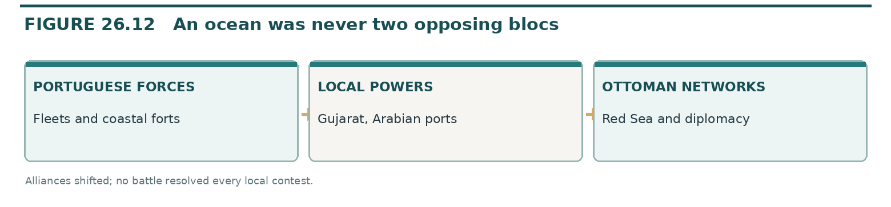

The Battle of Diu in 1509 gave the Portuguese an important naval victory over a coalition involving forces linked to Gujarat, the Mamluks and others. It helped establish Portuguese military prestige, but it did not close the Red Sea trade or eliminate Asian competitors. The battle has sometimes been portrayed as deciding control of the ocean for centuries; that claim greatly exceeds what a fleet engagement can prove about continuing shipping, tax collection and trade volumes.

After the Ottomans conquered Egypt in 1517, they inherited interests and responsibilities connected to Red Sea routes and pilgrimage. Ottoman campaigns, naval installations and diplomatic relationships developed in response to Portuguese activity and wider regional goals. The Ottoman expedition against Diu in 1538 ultimately failed to capture the fortified Portuguese position, but conflict did not reduce the western Indian Ocean to two uniform camps. Gujarati rulers, Arabian authorities, traders and coastal populations retained important choices.

Later contacts between Ottoman authorities and Aceh in Southeast Asia demonstrate both the breadth of Muslim diplomatic imagination and the difficulty of sustaining power across enormous distances. Accounts of artillery support, embassies or alliance need careful reading; they do not necessarily establish continuous direct Ottoman command in Sumatra. The western ocean remained a setting for negotiated coalitions, commercial persistence and intermittent warfare, rather than the settled possession of a single victorious empire. \[<a href="/026-indian-ocean-commerce-and-asian-powers/sources/#source-16" class="cite">16</a>\]\[<a href="/026-indian-ocean-commerce-and-asian-powers/sources/#source-17" class="cite">17</a>\]\[<a href="/026-indian-ocean-commerce-and-asian-powers/sources/#source-28" class="cite">28</a>\]

<figure class="figure" id="figure-26-12">

<figcaption>Figure 26.12. Alliances shifted; no battle resolved every local contest. <a class="figure-anchor" href="#figure-26-12" aria-label="Link to this figure">#</a></figcaption>
</figure>
