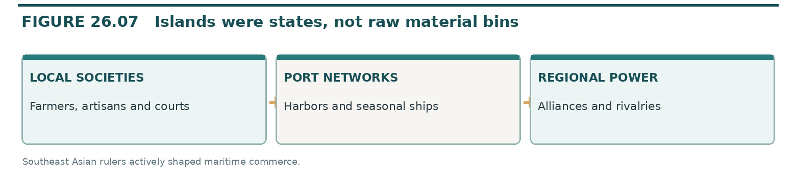

Southeast Asia's islands were not scattered producers waiting for outsiders to collect their crops. Java supported populous societies, agriculture, courts, religious traditions, craft production and seaborne trade. Majapahit, influential particularly in the fourteenth and early fifteenth centuries, shaped parts of the archipelago through a changing mixture of military campaigns, prestige, tributary relationships and local alliances. Claims of its territorial extent require care: later maps sometimes color a vast region as if it were administered like a modern nation-state.

The archipelago supplied products highly sought elsewhere, especially pepper, aromatic woods and spices associated with particular islands. But ships also carried grain, ceramics, timber and textiles between neighboring communities. Political power could arise from control of agricultural populations as well as from taxing maritime exchange. Local rulers judged when to welcome foreign merchants, protect a harbor or divert trade toward their own allies.

Over time, Islamic courts and trading communities gained influence in parts of maritime Southeast Asia, while Hindu-Buddhist practices continued elsewhere and remained important to cultural history. There was no single moment at which an entire region 'converted.' Conversion, commercial opportunity, dynastic politics, religious learning and household choices interacted in different ways on Sumatra, Java and other islands. The presence of mosques, inscriptions and changing court traditions documents historical transformation, but also leaves much about ordinary life unknown. \[<a href="/026-indian-ocean-commerce-and-asian-powers/sources/#source-1" class="cite">1</a>\]\[<a href="/026-indian-ocean-commerce-and-asian-powers/sources/#source-12" class="cite">12</a>\]\[<a href="/026-indian-ocean-commerce-and-asian-powers/sources/#source-22" class="cite">22</a>\]

<figure class="figure" id="figure-26-7">

<figcaption>Figure 26.7. Southeast Asian rulers actively shaped maritime commerce. <a class="figure-anchor" href="#figure-26-7" aria-label="Link to this figure">#</a></figcaption>
</figure>
