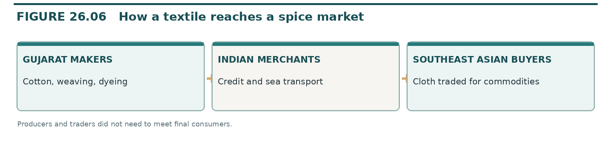

On India's southwest coast, Malabar ports were renowned for pepper and for merchants from many backgrounds. Calicut, associated with the ruler commonly called the Zamorin, became an important center of trade and diplomacy. Nearby Cochin and other ports competed and cooperated within a patchwork of regional powers. This political plurality mattered when Europeans arrived: newcomers could seek one ruler's alliance against another, while local rulers could use foreign ships for their own goals.

Pepper had local roots in farming, labor and ecological conditions. The commodity's value abroad should not make us forget growers, land tenure, brokers and transport from producing districts to port warehouses. The wealth of a trading city was shaped by its connections to production and by how reliably it could receive buyers, weigh goods, settle disputes and provision ships. Rival ports sometimes gained business when warfare or taxes made another less attractive.

Accounts written by early Portuguese visitors reveal fascination and occasional misunderstanding. They provide evidence for European expectations, military goals and observations, but cannot be treated as neutral surveys of Indian society. Some writers did not understand local religious practices or commercial customs. Comparing European records with regional texts, material evidence and later scholarship prevents the first foreign description from becoming the entire history of a thriving coast. \[<a href="/026-indian-ocean-commerce-and-asian-powers/sources/#source-2" class="cite">2</a>\]\[<a href="/026-indian-ocean-commerce-and-asian-powers/sources/#source-6" class="cite">6</a>\]\[<a href="/026-indian-ocean-commerce-and-asian-powers/sources/#source-20" class="cite">20</a>\]

<figure class="figure" id="figure-26-6">

<figcaption>Figure 26.6. Producers and traders did not need to meet final consumers. <a class="figure-anchor" href="#figure-26-6" aria-label="Link to this figure">#</a></figcaption>
</figure>
