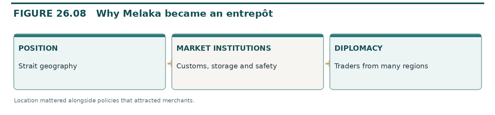

Melaka, on the Malay Peninsula, rose to prominence in the fifteenth century because it was well placed near the strait linking the Indian Ocean with the South China Sea. Its rulers developed relations with merchants from many regions and benefited from conditions that encouraged exchange. The port was not rich only because ships were forced to sail past it. A successful entrepôt needed authorities able to coordinate markets, collect taxes, reduce some kinds of insecurity and allow people of different backgrounds to trade.

The Melaka Sultanate developed diplomatic links with Ming China and participated in networks of Muslim merchants and scholars. Its court and legal customs evolved in a cosmopolitan setting, but it would be a mistake to describe every inhabitant as sharing an identical cultural identity. Indian, Chinese, Malay, Javanese and other communities interacted in different occupational and social positions. A shipment of Indian cloth could be exchanged for spices, which might then continue toward China or western markets.

In 1511 the Portuguese under Afonso de Albuquerque captured the port city. This did not mean every ship subsequently passed obediently through Portuguese customs. Some merchants favored alternative locations, including Aceh and Johor, and competing routes gained importance. Melaka's importance as a crossroads survived political change, while the effects on its commercial population were substantial and uneven. Today, UNESCO recognizes its long multicultural history, but a modern heritage listing cannot substitute for the complex story of particular fifteenth- and sixteenth-century communities. \[<a href="/026-indian-ocean-commerce-and-asian-powers/sources/#source-12" class="cite">12</a>\]\[<a href="/026-indian-ocean-commerce-and-asian-powers/sources/#source-22" class="cite">22</a>\]\[<a href="/026-indian-ocean-commerce-and-asian-powers/sources/#source-24" class="cite">24</a>\]

<figure class="figure" id="figure-26-8">

<figcaption>Figure 26.8. Location mattered alongside policies that attracted merchants. <a class="figure-anchor" href="#figure-26-8" aria-label="Link to this figure">#</a></figcaption>
</figure>
