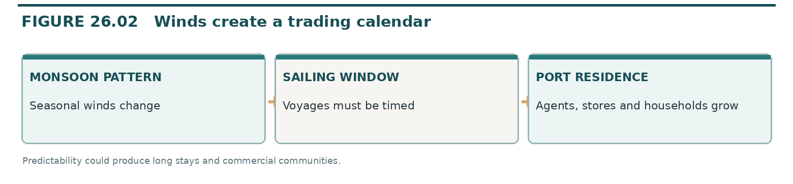

The monsoon is a seasonal pattern of winds and rainfall driven by the changing heating of land and sea and by larger atmospheric circulation. In broad terms, southwesterly winds tend to dominate much of the northern Indian Ocean during the boreal summer, while northeasterly winds become important during the winter. Exact timing, sea conditions and direction vary substantially by region. Sailors therefore needed local knowledge, not just a rule saying 'travel east in summer and west in winter.'

Monsoons made voyages more predictable but also created waiting. If a captain arrived after a seasonal departure window, a crew might remain in a port for months. This was costly, yet the enforced pause helped create resident trading communities. Merchants established agents, storage facilities, marriages, patronage relationships and legal methods for resolving disputes. Commercial calendars also shaped rulers' revenue: a port that offered safe anchorage, supplies and trustworthy exchange could attract fleets during a short trading season.

A useful counterfactual illustrates the importance of weather. Imagine the same textiles, spices and eager buyers, but no winds that could be anticipated from year to year. Voyages would have faced much greater uncertainty and capital might have stayed closer to home. Monsoon knowledge reduced some uncertainty without removing storms, piracy, shifting sandbanks or navigation mistakes. It was a form of accumulated practical science, transmitted through skilled seafarers and port communities across generations. \[<a href="/026-indian-ocean-commerce-and-asian-powers/sources/#source-1" class="cite">1</a>\]\[<a href="/026-indian-ocean-commerce-and-asian-powers/sources/#source-3" class="cite">3</a>\]\[<a href="/026-indian-ocean-commerce-and-asian-powers/sources/#source-5" class="cite">5</a>\]

<figure class="figure" id="figure-26-2">

<figcaption>Figure 26.2. Predictability could produce long stays and commercial communities. <a class="figure-anchor" href="#figure-26-2" aria-label="Link to this figure">#</a></figcaption>
</figure>
