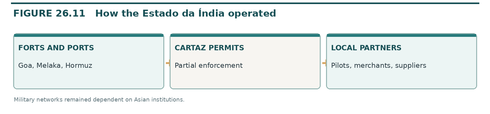

During the sixteenth century, Portuguese authorities attempted to secure strategic positions, including Goa, captured in 1510, and Melaka in 1511; Hormuz became a key outpost in 1515. The Estado da Índia was a dispersed framework of forts, officials, settlements and maritime claims rather than a compact territory covering all of India. Its naval strength and administrative ambition were real, yet the areas it could police were limited by distance, costs, rival forces and local politics.

The cartaz system, often described as a maritime pass regime, sought to require some shipping to obtain Portuguese authorization under threat of seizure. Its rules and enforcement varied across routes and periods. This was an effort to extract revenue and exercise control over shipping, not evidence that every Asian merchant accepted Portuguese dominion. Some voyages avoided patrols, took alternative routes, negotiated special treatment or carried goods on Portuguese ships. European and Asian actors could both cooperate and fight.

The Portuguese sometimes strengthened rival ports by trying to damage traditional entrepôts. They also depended on local financiers, pilots, merchants and labor. Such dependence complicates triumphant language about mastery of an entire ocean. Military advantage at a narrow approach was not equivalent to producing cotton cloth, supplying food to every harbor or commanding a huge population inland. The resulting commercial order remained hybrid and contested. \[<a href="/026-indian-ocean-commerce-and-asian-powers/sources/#source-2" class="cite">2</a>\]\[<a href="/026-indian-ocean-commerce-and-asian-powers/sources/#source-18" class="cite">18</a>\]\[<a href="/026-indian-ocean-commerce-and-asian-powers/sources/#source-27" class="cite">27</a>\]

<figure class="figure" id="figure-26-11">

<figcaption>Figure 26.11. Military networks remained dependent on Asian institutions. <a class="figure-anchor" href="#figure-26-11" aria-label="Link to this figure">#</a></figcaption>
</figure>
