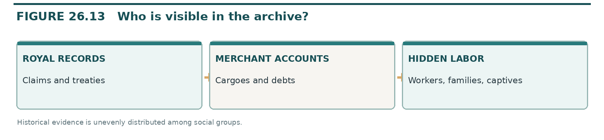

Enslavement was part of the wider Indian Ocean world, including forms of household service, military dependence, maritime transport and labor in particular regions. Individuals were forcibly displaced across coasts and inland routes; some were subjected to severe violence and lasting loss of freedom. The institutions varied by place and period, and evidence is uneven. We should neither minimize coercion by noting that slavery took different forms nor equate every Indian Ocean institution mechanically with the Atlantic plantation system studied in Chapter 29.

Religious law, warfare, debt, captivity and commercial demand could affect the routes into enslavement. Free and unfree people sometimes traveled on the same ship, but their experiences cannot be merged into a celebratory story of cultural exchange. A forced migrant might carry language, skill and belief to a distant household while having no choice in the journey. Cultural transmission is not proof of freedom or consent.

Historians are especially cautious about quantitative claims. Surviving registers do not cover every voyage, and later periods can be documented far more fully than earlier ones. The massive nineteenth-century commerce connected to eastern Africa, the Arabian Peninsula and Indian Ocean islands cannot simply be assumed to have operated at identical scale in 1500. A responsible account identifies known practices, acknowledges missing evidence and keeps human suffering visible even when totals remain contested. \[<a href="/026-indian-ocean-commerce-and-asian-powers/sources/#source-13" class="cite">13</a>\]\[<a href="/026-indian-ocean-commerce-and-asian-powers/sources/#source-14" class="cite">14</a>\]\[<a href="/026-indian-ocean-commerce-and-asian-powers/sources/#source-30" class="cite">30</a>\]

<figure class="figure" id="figure-26-13">

<figcaption>Figure 26.13. Historical evidence is unevenly distributed among social groups. <a class="figure-anchor" href="#figure-26-13" aria-label="Link to this figure">#</a></figcaption>
</figure>
