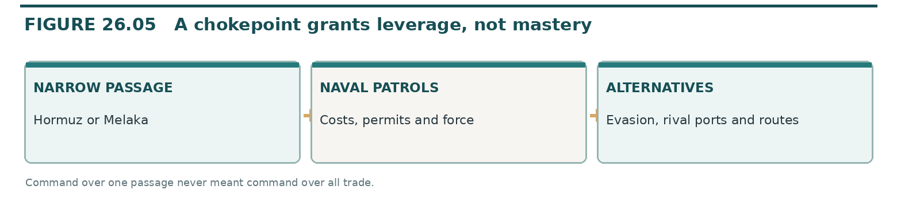

The Persian Gulf linked the sea to Iranian, Arabian and Mesopotamian markets. Hormuz became a major trading center because of geography, political protection, finance and its position near the approaches to the Gulf. Merchants could connect maritime cargoes with inland routes toward Iran and beyond. Gulf ports handled goods including horses, pearls, textiles and products that had already passed through several intermediaries. The ruler of a port might earn money by taxing goods rather than owning them outright.

The political scene was complicated. Local rulers negotiated with competing regional powers, including states in Iran and Arabia; merchants pursued their own interests and could shift ports when conditions changed. When the Portuguese eventually secured a commanding position at Hormuz in the early sixteenth century, it was not a simple transfer from 'Asian freedom' to 'European control.' It layered new military and fiscal demands onto older arrangements, and the limits of Portuguese enforcement remained important.

Calling Hormuz a 'chokepoint' is useful only if we specify what can actually be controlled. A warship at the mouth of a gulf can threaten shipping. It cannot necessarily force merchants to use a particular warehouse, prevent smuggling or eliminate substitute markets. Geography grants leverage, not omnipotence. This distinction between positional advantage and effective political authority will recur at Goa, Melaka and the Red Sea. \[<a href="/026-indian-ocean-commerce-and-asian-powers/sources/#source-2" class="cite">2</a>\]\[<a href="/026-indian-ocean-commerce-and-asian-powers/sources/#source-3" class="cite">3</a>\]\[<a href="/026-indian-ocean-commerce-and-asian-powers/sources/#source-18" class="cite">18</a>\]

<figure class="figure" id="figure-26-5">

<figcaption>Figure 26.5. Command over one passage never meant command over all trade. <a class="figure-anchor" href="#figure-26-5" aria-label="Link to this figure">#</a></figcaption>
</figure>
