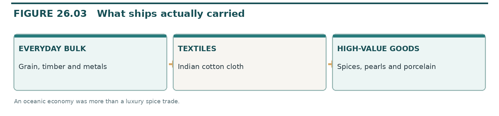

Stories about 'the spice trade' can make Indian Ocean commerce sound like an exchange of luxurious seasonings among wealthy consumers. Pepper, cloves, nutmeg, mace and cinnamon mattered greatly, but textiles were central to many circuits. Indian cotton cloth varied from plain, relatively inexpensive fabric to finely patterned and dyed products. Merchants brought cloth to African and Southeast Asian markets, where designs, colors, measurements and quality often had to match local preferences.

Other goods included rice, wheat, sugar, timber, metals, horses, ceramics, pearls, medicinal substances, incense and everyday household objects. Bulk commodities provided food and materials for cities and ships; specialty products made some voyages especially profitable. A large quantity of an ordinary item could be more important to an economy than a tiny shipment commanding spectacular prices. Chinese porcelain, for instance, traveled over long distances and survives in archaeological excavations partly because fired ceramics preserve well. That does not mean every traveler owned porcelain or that pottery alone measures trade volume.

Markets worked through substitution and changing tastes. A buyer might reject a cloth pattern favored elsewhere, while a ruler seeking cavalry horses could pay a premium for reliable imported animals. The historian's task is to ask not simply 'What was traded?' but 'Who produced it, why did another region value it, and what institutions brought the two together?' \[<a href="/026-indian-ocean-commerce-and-asian-powers/sources/#source-4" class="cite">4</a>\]\[<a href="/026-indian-ocean-commerce-and-asian-powers/sources/#source-8" class="cite">8</a>\]\[<a href="/026-indian-ocean-commerce-and-asian-powers/sources/#source-9" class="cite">9</a>\]

<figure class="figure" id="figure-26-3">

<figcaption>Figure 26.3. An oceanic economy was more than a luxury spice trade. <a class="figure-anchor" href="#figure-26-3" aria-label="Link to this figure">#</a></figcaption>
</figure>
