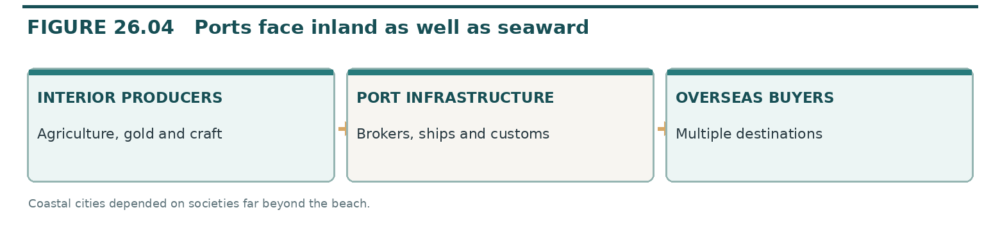

From the northern Kenyan coast to present-day Tanzania and farther south, Swahili-speaking communities developed urban and maritime cultures that connected African hinterlands to overseas trade. Cities such as Kilwa, Mombasa and Malindi drew strength from their local political networks, fishing, craft production, agriculture and commercial contacts. Their architecture, mosques, coinage and imported ceramics testify to sustained engagement with the wider ocean. Yet the societies that built these ports were African communities, not foreign colonies dropped onto an otherwise empty shore.

Overseas links influenced material culture and religion. Islam became important in many coastal communities, and connections with Arabia, Persia and India shaped some styles and institutions. The language now called Swahili is Bantu in its grammatical foundations, although it contains important borrowed vocabulary. Calling Swahili civilization merely 'Arab' therefore mistakes cultural contact for the origins of the people themselves. Historians combine archaeology and locally produced evidence with accounts written by travelers whose judgments reflected unfamiliar expectations.

A port's prosperity also rested on inland relationships and could involve violence or exploitation. Gold, ivory and other goods moved toward coastal markets from regions connected by merchants and political intermediaries. Slave trading was part of Indian Ocean history as well, though its scale, routes and institutions changed over time. We must not project the enormous nineteenth-century East African slave trade backward unchanged onto the fifteenth century. Understanding Africa's agency means acknowledging its commercial achievements without erasing coercion. \[<a href="/026-indian-ocean-commerce-and-asian-powers/sources/#source-13" class="cite">13</a>\]\[<a href="/026-indian-ocean-commerce-and-asian-powers/sources/#source-14" class="cite">14</a>\]\[<a href="/026-indian-ocean-commerce-and-asian-powers/sources/#source-15" class="cite">15</a>\]

<figure class="figure" id="figure-26-4">

<figcaption>Figure 26.4. Coastal cities depended on societies far beyond the beach. <a class="figure-anchor" href="#figure-26-4" aria-label="Link to this figure">#</a></figcaption>
</figure>
