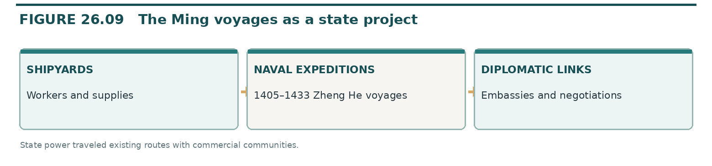

From 1405 to 1433, fleets commanded by Zheng He and colleagues undertook seven major Ming voyages through Southeast Asia and the Indian Ocean. The expeditions visited important trading ports in South Asia, and their routes eventually extended to the Persian Gulf and East African coast. Contemporary records, inscriptions and later compilations document their diplomatic and maritime significance, although exact fleet sizes and some sensational descriptions of immense ships remain debated.

These were not merely peaceful cruises or simple voyages of exploration into an unknown world. The fleets operated along existing routes and visited experienced commercial societies. Ming representatives offered gifts, received envoys and sought political recognition. At times force accompanied diplomacy, as in interventions affecting regional conflicts. The state's impressive capacity to mobilize ships and personnel depended on shipbuilding centers, skilled workers, provisions and costly administration. It was a form of imperial projection rooted in China's domestic resources.

The later reduction in such enormous official voyages has often been narrated as proof that China 'turned away from the sea.' That is too simple. Court priorities, fiscal costs, northern frontier security, differing policies toward private commerce and local economic activity all matter. Maritime exchange did not vanish when the giant court fleets stopped sailing. A useful comparison with later Portuguese expeditions asks whether different state projects were meant to collect tribute, establish commercial stations, enforce exclusive trade or achieve more than one of these at once. \[<a href="/026-indian-ocean-commerce-and-asian-powers/sources/#source-5" class="cite">5</a>\]\[<a href="/026-indian-ocean-commerce-and-asian-powers/sources/#source-25" class="cite">25</a>\]\[<a href="/026-indian-ocean-commerce-and-asian-powers/sources/#source-26" class="cite">26</a>\]

<figure class="figure" id="figure-26-9">

<figcaption>Figure 26.9. State power traveled existing routes with commercial communities. <a class="figure-anchor" href="#figure-26-9" aria-label="Link to this figure">#</a></figcaption>
</figure>
