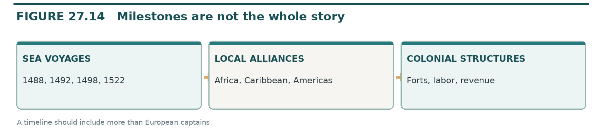

Several dates anchor the main sequence. In 1415 Portuguese forces took Ceuta. Portuguese Atlantic settlement expanded across Madeira and the Azores in the fifteenth century; contact and violence developed along western African shores. In 1482 Elmina fortress was established. Dias rounded the Cape in 1488. Columbus reached the Caribbean in 1492; Portugal and Castile agreed the Treaty of Tordesillas in 1494; da Gama reached Calicut in 1498; and Cabral reached Brazil in 1500. \[<a href="/027-european-maritime-expansion/sources/#source-1" class="cite">1</a>\]\[<a href="/027-european-maritime-expansion/sources/#source-3" class="cite">3</a>\]\[<a href="/027-european-maritime-expansion/sources/#source-6" class="cite">6</a>\]

In 1507 Waldseemüller's map used the name America. Magellan's expedition departed in 1519; Cortés's coalition took Tenochtitlan in 1521; and Elcano's surviving crew completed circumnavigation in 1522. Pizarro's seizure of Atahualpa occurred in 1532. A Spanish return route across the Pacific developed in 1565, and Manila became a colonial center in 1571. These dates help order developments, but they do not describe simultaneous transformation in every connected society. \[<a href="/027-european-maritime-expansion/sources/#source-2" class="cite">2</a>\]\[<a href="/027-european-maritime-expansion/sources/#source-21" class="cite">21</a>\]\[<a href="/027-european-maritime-expansion/sources/#source-25" class="cite">25</a>\]

A chronology can itself be misleading if every line names only a European commander. Alongside the voyages stood African kingdoms, Taíno societies, Mesoamerican coalitions, Andean polities, Indian port cities and Pacific island communities. They shaped what happened, though conventional expedition timelines tend not to name them. A better timeline tracks encounters, resistance and institution-building as well as ship departures.

<figure class="figure" id="figure-27-14">

<figcaption>Figure 27.14. A timeline should include more than European captains. <a class="figure-anchor" href="#figure-27-14" aria-label="Link to this figure">#</a></figcaption>
</figure>
