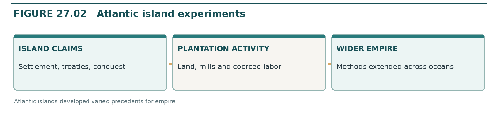

Portugal's seizure of Ceuta in 1415 is often treated as an early marker of expansion, though Ceuta was a North African port with its own established history. In the following decades Portuguese settlement developed on Madeira and the Azores; the Canary Islands became an arena of Castilian conquest, in which Indigenous Guanche communities resisted and suffered dispossession and enslavement. Cape Verde and São Tomé later became important to Atlantic commerce and settlement. Islanders' experiences differed greatly: some islands were without permanent human populations when Europeans established colonies, whereas others were already inhabited. \[<a href="/027-european-maritime-expansion/sources/#source-6" class="cite">6</a>\]\[<a href="/027-european-maritime-expansion/sources/#source-10" class="cite">10</a>\]\[<a href="/027-european-maritime-expansion/sources/#source-11" class="cite">11</a>\]

These Atlantic ventures provided practice in organizing settlement, distributing land, taxing commerce and producing export crops. Madeira's sugar cultivation and the plantation systems that developed on Atlantic islands helped create techniques later expanded in the Americas. Plantation history involved complex arrangements of land, capital, mills and labor, including slavery and coercion. Chapter 29 will examine the growth of Atlantic slavery in much greater depth. \[<a href="/027-european-maritime-expansion/sources/#source-10" class="cite">10</a>\]\[<a href="/027-european-maritime-expansion/sources/#source-11" class="cite">11</a>\]

The island story matters because later conquest was not invented overnight in 1492. Expeditions carried experience accumulated over several generations: how to bargain for financial backing, allocate property, recruit or compel workers and build institutions far from the metropolitan court. But experience did not guarantee success, and the consequences for colonized peoples were not just technical 'lessons' for European administrators.

<figure class="figure" id="figure-27-2">

<figcaption>Figure 27.2. Atlantic islands developed varied precedents for empire. <a class="figure-anchor" href="#figure-27-2" aria-label="Link to this figure">#</a></figcaption>
</figure>
