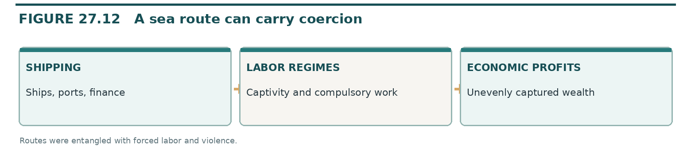

Portuguese voyages and Atlantic island plantation systems helped develop institutions that would feed into the later transatlantic trafficking of enslaved Africans. Enslavement existed in many societies before European Atlantic ventures, but that background cannot excuse the new scale, routes and commercial organization of the Atlantic system. People were captured, purchased, transported and compelled to labor under violence and deprivation. African societies experienced varying political and social effects, including conflict and resistance. \[<a href="/027-european-maritime-expansion/sources/#source-15" class="cite">15</a>\]\[<a href="/027-european-maritime-expansion/sources/#source-16" class="cite">16</a>\]

The early phases of this system did not yet resemble its full seventeenth- and eighteenth-century extent. Distinguishing periods avoids the error of projecting a later structure backward unchanged. At the same time, calling an early venture merely 'trade' conceals the moral and historical fact that human beings were treated as commodities. Careful terminology matters. \[<a href="/027-european-maritime-expansion/sources/#source-15" class="cite">15</a>\]\[<a href="/027-european-maritime-expansion/sources/#source-16" class="cite">16</a>\]

Chapter 29 will examine the Atlantic slave trade and plantation economies directly, including the roles of European states and merchants, African political actors, resistance and abolition. The point here is structural: expansion at sea opened economic possibilities, and coercive labor regimes became an essential part of how some of those possibilities were realized. A history interested only in ships and spices is incomplete.

<figure class="figure" id="figure-27-12">

<figcaption>Figure 27.12. Routes were entangled with forced labor and violence. <a class="figure-anchor" href="#figure-27-12" aria-label="Link to this figure">#</a></figcaption>
</figure>
