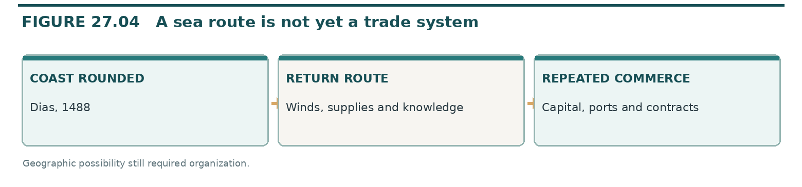

In 1488 Bartolomeu Dias rounded southern Africa, demonstrating that the Atlantic and Indian oceans could be connected by sea through the Cape route. The voyage built on decades of progress southward and on accumulated knowledge of sailing conditions. Dias did not instantly create a profitable route to India; it remained necessary to organize vessels and supplies, negotiate encounters along an unfamiliar coast and navigate the western Indian Ocean. \[<a href="/027-european-maritime-expansion/sources/#source-1" class="cite">1</a>\]\[<a href="/027-european-maritime-expansion/sources/#source-6" class="cite">6</a>\]

An ocean route also requires a return journey. A ship that reaches a destination but cannot sail back safely produces little sustainable commerce. The Cape journey revealed a geographic possibility while raising new practical problems: where to obtain water, how to manage scurvy and other diseases, how to communicate with coastal inhabitants, and which seasonal winds could carry a vessel across to India. The optimistic phrase 'route discovered' is therefore only the beginning of a larger economic story.

Dias's place in history is secure without embellishment. We need not imagine the expedition's every word or exact onboard drama to understand its importance. Many familiar scenes of storm-tossed captains and momentous speeches come from later retellings. The strongest historical explanation is modest and more impressive: the expedition confirmed a navigable geographic connection that subsequent sailors and governments could build into repeatable voyages.

<figure class="figure" id="figure-27-4">

<figcaption>Figure 27.4. Geographic possibility still required organization. <a class="figure-anchor" href="#figure-27-4" aria-label="Link to this figure">#</a></figcaption>
</figure>
