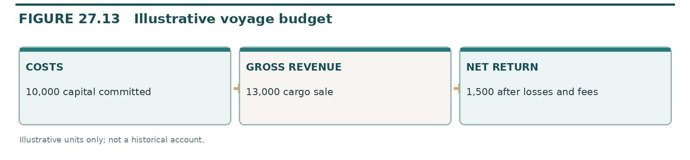

Consider an invented voyage financed with 10,000 units of capital. Ships and repairs require 3,000; wages and provisions 2,500; credit and port charges 1,000; armed protection 1,500; and a reserve for unexpected costs 2,000. The venture must recover more than the 10,000 committed before its investors make a net profit. If a cargo sells for 13,000 but 1,500 is lost to spoilage and additional fees, the apparent 3,000 gain shrinks to 1,500 before any further obligations. These numbers are illustrative, not historical accounts. \[<a href="/027-european-maritime-expansion/sources/#source-18" class="cite">18</a>\]

Now imagine two investors. One wants a high-value cargo sold in Europe; another wants a fortified coastal position to support a sequence of future voyages. The first evaluates immediate profit; the second considers future customs revenue, strategic leverage and maintenance costs. The ruler might value political prestige even when the venture does not pay. The crew might value wages and survival, while a local ruler might judge whether allowing the ships into port would strengthen a rival. The same expedition can therefore be assessed very differently by actors with different incentives.

This exercise explains why the phrase 'Portugal became rich from discovery' is too vague to teach much. Who profited, when, from what activity and at whose expense? A profitable merchant voyage is not identical to a positive fiscal outcome for the state, still less to better living conditions for everyone in the society.

<figure class="figure" id="figure-27-13">

<figcaption>Figure 27.13. Illustrative units only; not a historical account. <a class="figure-anchor" href="#figure-27-13" aria-label="Link to this figure">#</a></figcaption>
</figure>
