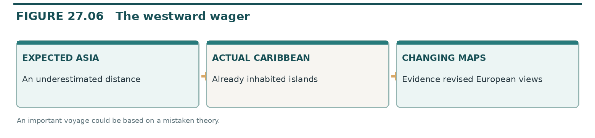

Christopher Columbus, a Genoese mariner who secured backing from the Castilian crown, proposed reaching Asia by sailing west across the Atlantic. Educated Europeans generally accepted that Earth was spherical; the central dispute was not whether a ship would fall off its edge, but how far it would need to travel and how much ocean separated Europe from Asia. Columbus badly underestimated the distance to Asia and misunderstood the intervening geography. His success in reaching land should not be confused with being correct about the route's intended destination. \[<a href="/027-european-maritime-expansion/sources/#source-2" class="cite">2</a>\]\[<a href="/027-european-maritime-expansion/sources/#source-3" class="cite">3</a>\]\[<a href="/027-european-maritime-expansion/sources/#source-19" class="cite">19</a>\]

In 1492 three ships crossed the Atlantic from the Canary Islands and reached the Bahamas, where Columbus encountered Taíno-speaking islanders. He believed he had reached islands associated with the Indies. The word 'Indians' applied to Indigenous American peoples grew from that mistaken geography and survives in many historical documents; it should never imply that the people actually came from South Asia. Columbus went on to make several voyages, establishing claims and settlements that rapidly transformed the Caribbean. \[<a href="/027-european-maritime-expansion/sources/#source-2" class="cite">2</a>\]\[<a href="/027-european-maritime-expansion/sources/#source-19" class="cite">19</a>\]

The historical significance of the crossing is immense because it began sustained, increasingly consequential European-American contact under the expanding Spanish monarchy. It was not the first human presence in the Americas, and it was not even the first known European landing there: Norse voyagers reached northeastern North America centuries earlier. Its importance is the durability, scale and state support of subsequent transatlantic connections, not a magical 'first discovery' of a populated hemisphere.

<figure class="figure" id="figure-27-6">

<figcaption>Figure 27.6. An important voyage could be based on a mistaken theory. <a class="figure-anchor" href="#figure-27-6" aria-label="Link to this figure">#</a></figcaption>
</figure>
