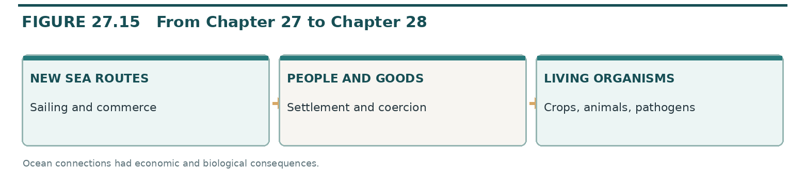

Maritime expansion means the development of sustained overseas voyages, commercial relationships, territorial claims and institutions of control. Caravel is a relatively maneuverable sailing vessel used in some Iberian ventures; carrack or nau refers to larger ocean-going vessels able to carry substantial cargoes. Volta do mar describes routing voyages to exploit Atlantic wind and current systems. Dead reckoning estimates position using direction, speed and elapsed time. Entrepôt is a trading port where goods are collected and redistributed. \[<a href="/027-european-maritime-expansion/sources/#source-5" class="cite">5</a>\]\[<a href="/027-european-maritime-expansion/sources/#source-8" class="cite">8</a>\]

Treaty of Tordesillas refers to the 1494 agreement dividing Iberian claims overseas; it did not represent consent by the inhabitants of those territories. Encomienda refers to a colonial institution allocating specified Indigenous tribute or labor obligations to Spanish grantees, not an uncomplicated form of private ownership. Colonial claim is a government's assertion; effective control is the authority it can actually enforce. Indigenous agency means the decisions and actions of colonized peoples, including alliances, resistance, accommodation and survival. \[<a href="/027-european-maritime-expansion/sources/#source-3" class="cite">3</a>\]\[<a href="/027-european-maritime-expansion/sources/#source-23" class="cite">23</a>\]\[<a href="/027-european-maritime-expansion/sources/#source-28" class="cite">28</a>\]

The overall lesson is that European maritime expansion connected pre-existing worlds through new routes and institutions while radically changing the balance of power in many regions. It created opportunities for circulation and learning, and it also enabled organized exploitation, forced conversion, conquest and enslavement. Chapter 28 will focus on the movement of organisms, pathogens and populations that followed these connections—the Columbian Exchange. Its biological consequences cannot be understood apart from the human decisions and political systems examined here.

<figure class="figure" id="figure-27-15">

<figcaption>Figure 27.15. Ocean connections had economic and biological consequences. <a class="figure-anchor" href="#figure-27-15" aria-label="Link to this figure">#</a></figcaption>
</figure>
