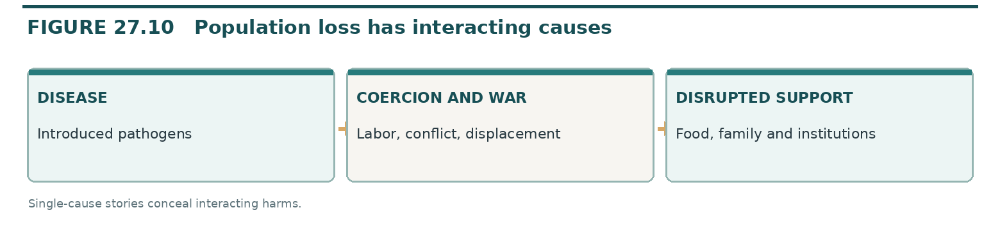

Old World diseases introduced into the Americas had devastating consequences for Indigenous populations lacking prior exposure to some of these pathogens. Smallpox and other infections contributed to demographic disasters in many regions. But a simple formula—'germs conquered the Americas'—can hide the effects of forced labor, war, displacement, hunger, social disruption and colonial policy. The timing and balance of causes varied considerably by region and period. \[<a href="/027-european-maritime-expansion/sources/#source-2" class="cite">2</a>\]\[<a href="/027-european-maritime-expansion/sources/#source-19" class="cite">19</a>\]\[<a href="/027-european-maritime-expansion/sources/#source-20" class="cite">20</a>\]

Demographic reconstruction also requires caution. Sixteenth-century observers did not conduct modern censuses of the pre-contact Americas. Historians and demographers estimate losses using tribute lists, archaeological evidence, ecological indicators and surviving accounts; the uncertainties are significant. Wide differences between estimates should not become excuses to deny suffering, nor invitations to repeat spectacular figures as if they were exact counts. \[<a href="/027-european-maritime-expansion/sources/#source-20" class="cite">20</a>\]\[<a href="/027-european-maritime-expansion/sources/#source-28" class="cite">28</a>\]

An epidemic has social mechanisms, not just biological ones. People who must flee farms or are compelled into mines may be unable to sustain food production. Communities losing elders and specialists face disruptions to knowledge transmission. A disease can spread along trade or military routes, while a colonial administration can worsen its consequences by controlling movement or imposing labor demands. Chapter 28 will explore these ecological, demographic and material connections in much greater detail.

<figure class="figure" id="figure-27-10">

<figcaption>Figure 27.10. Single-cause stories conceal interacting harms. <a class="figure-anchor" href="#figure-27-10" aria-label="Link to this figure">#</a></figcaption>
</figure>
