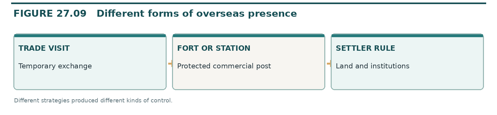

An expedition might visit a coast, proclaim possession and sail away. A colony required repeated investment and mechanisms of rule: settlers, garrisons, food supplies, land arrangements, legal institutions and the cooperation—or subjugation—of local populations. Establishing a colony therefore changed a voyage from an event into an enduring political relationship. The process was uneven; empires often attempted claims they could not enforce for generations. \[<a href="/027-european-maritime-expansion/sources/#source-2" class="cite">2</a>\]\[<a href="/027-european-maritime-expansion/sources/#source-10" class="cite">10</a>\]\[<a href="/027-european-maritime-expansion/sources/#source-18" class="cite">18</a>\]

It helps to distinguish four overlapping forms of overseas presence. A seasonal trading visit depended on exchange without permanent control. A fortified commercial post attempted to secure a harbor or market. A settler colony sought to hold and cultivate land over time. A conquest state subordinated existing territories and populations to new governing institutions. These categories were not mutually exclusive, and one place could shift between them. \[<a href="/027-european-maritime-expansion/sources/#source-10" class="cite">10</a>\]\[<a href="/027-european-maritime-expansion/sources/#source-18" class="cite">18</a>\]

Colonial rule also changed the incentives of people already present. Some communities formed alliances to protect themselves against neighbors or acquire new goods; others resisted territorial claims, labor demands or missionary pressure. Some partnerships later dissolved as colonial authorities strengthened. Describing all cooperation as 'voluntary acceptance' would ignore the unequal alternatives and changing conditions. The creation of empire was a long series of contested relationships, not the automatic result of a landing.

<figure class="figure" id="figure-27-9">

<figcaption>Figure 27.9. Different strategies produced different kinds of control. <a class="figure-anchor" href="#figure-27-9" aria-label="Link to this figure">#</a></figcaption>
</figure>
