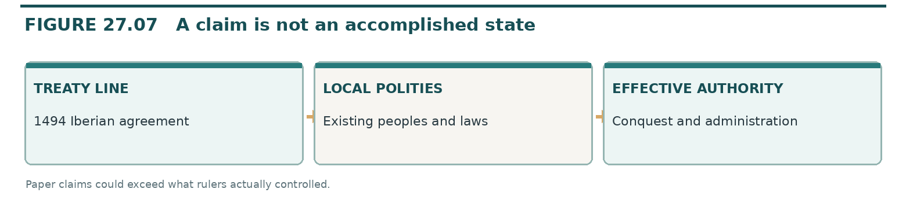

Columbus's voyages initially fitted European expectations about eastern Asia. Subsequent expeditions and geographic arguments gradually made it clearer that large landmasses lay between the Atlantic and the presumed Asian destination. The 1507 world map associated with Martin Waldseemüller famously used the name 'America,' derived from Amerigo Vespucci, for part of the newly charted land. This reflects changing European interpretation, not a moment when an inhabited continent came into existence. \[<a href="/027-european-maritime-expansion/sources/#source-21" class="cite">21</a>\]\[<a href="/027-european-maritime-expansion/sources/#source-22" class="cite">22</a>\]

Cartography was a political tool as well as an intellectual one. Printed maps could advertise claims, identify ports, inspire investors and persuade readers that new territories were available to be ruled. Maps often privileged coastlines known to sailors, while interior populations were represented with fanciful images or omitted. A border line drawn confidently on paper was not the same as actual jurisdiction on land. \[<a href="/027-european-maritime-expansion/sources/#source-21" class="cite">21</a>\]\[<a href="/027-european-maritime-expansion/sources/#source-22" class="cite">22</a>\]

Consider what is absent from a map showing only Portuguese and Spanish colors. It may display no Indigenous polity, no African kingdom, and no distinction between a claimed island and a successfully occupied port. This graphic simplification is historically consequential: readers can mistake royal ambition for accomplished rule. Learning to read a map critically requires asking whose names are printed, whose settlements are invisible, and which claims the mapmaker had an interest in promoting.

<figure class="figure" id="figure-27-7">

<figcaption>Figure 27.7. Paper claims could exceed what rulers actually controlled. <a class="figure-anchor" href="#figure-27-7" aria-label="Link to this figure">#</a></figcaption>
</figure>
