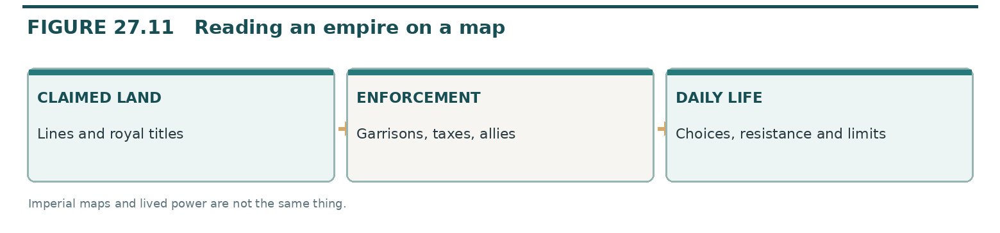

European powers used expansive language about dominion, exclusive trade and universal monarchy, but enforcement varied enormously. The early Portuguese Estado da Índia relied on scattered forts, ports and passes in an Indian Ocean still dominated in many areas by Asian merchants and rulers. Spanish American colonies controlled substantial territories but also contained enduring autonomous Indigenous regions and recurrent resistance. Both governments depended on private finance, local intermediaries and limited administrative capacity. \[<a href="/027-european-maritime-expansion/sources/#source-4" class="cite">4</a>\]\[<a href="/027-european-maritime-expansion/sources/#source-6" class="cite">6</a>\]\[<a href="/027-european-maritime-expansion/sources/#source-18" class="cite">18</a>\]

Rival Europeans could attack shipping, contest monopolies or establish their own overseas enterprises. Coastal African and Asian rulers retained bargaining power in many encounters. Storms, costs and resistance constantly exposed the distance between imperial proclamations and effective authority. Even within colonies, rules could be negotiated, ignored or modified by distant officials. \[<a href="/027-european-maritime-expansion/sources/#source-4" class="cite">4</a>\]\[<a href="/027-european-maritime-expansion/sources/#source-13" class="cite">13</a>\]

When examining an empire on a map, ask three questions. What was legally claimed? What could the crown actually enforce? What did inhabitants experience in daily life? These answers may differ sharply. Empire was not a single switch that turned on after a voyage; it was a layered, changing set of power relationships developed through commerce, warfare, settlement and administration.

<figure class="figure" id="figure-27-11">

<figcaption>Figure 27.11. Imperial maps and lived power are not the same thing. <a class="figure-anchor" href="#figure-27-11" aria-label="Link to this figure">#</a></figcaption>
</figure>
