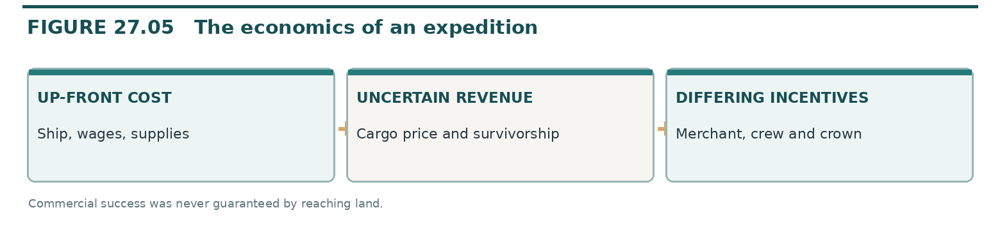

Imagine an investor funding a ship whose timber, rigging, guns, provisions and crew wages must be paid before a cargo can be sold. The voyage takes many months or years. Some sailors die; some merchandise spoils; storms or hostile forces may destroy the ship. Even a successful arrival might reveal that the planned goods are unwelcome in the destination market. Profits therefore require more than a high price for pepper or gold in Europe. They require financing, insurance or risk sharing, enforcement of contracts, and an effective system of repeated expeditions. \[<a href="/027-european-maritime-expansion/sources/#source-1" class="cite">1</a>\]\[<a href="/027-european-maritime-expansion/sources/#source-6" class="cite">6</a>\]\[<a href="/027-european-maritime-expansion/sources/#source-18" class="cite">18</a>\]

Rulers could grant monopolies and privileges in exchange for expected revenue, but legal titles did not abolish risk. Merchants and financiers supplied credit and technical knowledge. The crown might collect customs or control a trading institution while contracting with private operators. Ships often carried military force because states attempted to extract a portion of trade by restricting rivals. Military spending was itself a cost, and competitors could evade or challenge a blockade.

This helps explain why spectacular discoveries did not immediately make every maritime sponsor rich. A successful route could bankrupt a particular expedition; a heavily armed fort could cost more than it collected; and a thriving commercial system might benefit foreign or local intermediaries rather than a royal treasury. Early expansion mixed entrepreneurship, state revenue seeking and organized coercion, often in unstable proportions.

<figure class="figure" id="figure-27-5">

<figcaption>Figure 27.5. Commercial success was never guaranteed by reaching land. <a class="figure-anchor" href="#figure-27-5" aria-label="Link to this figure">#</a></figcaption>
</figure>
