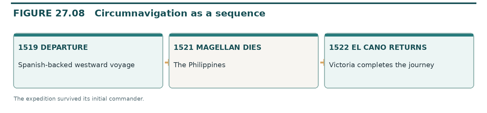

In 1519 an expedition sponsored by the Spanish monarchy departed under Ferdinand Magellan, a Portuguese-born navigator. Its purpose included reaching the spice-producing islands of Southeast Asia by sailing west. The fleet crossed the Atlantic, passed through the strait at South America's southern tip now associated with Magellan, and entered the Pacific. That vast crossing exposed the serious errors in earlier estimates of the planet's oceanic distances. Magellan was killed in the Philippines in 1521. The remaining voyage was completed by the ship Victoria under Juan Sebastián Elcano in 1522. \[<a href="/027-european-maritime-expansion/sources/#source-25" class="cite">25</a>\]\[<a href="/027-european-maritime-expansion/sources/#source-26" class="cite">26</a>\]

The circumnavigation established through direct sailing experience that a continuous voyage around the globe was possible, though a globe's spherical form had been accepted in learned traditions long before. It also dramatized the differences between a map's promise and the bodily costs of travel. Crews faced shortages, illness, conflict and loss of ships. Indigenous societies encountered along the route had their own alliances and political rivalries; they were not scenery for a European demonstration. \[<a href="/027-european-maritime-expansion/sources/#source-25" class="cite">25</a>\]\[<a href="/027-european-maritime-expansion/sources/#source-26" class="cite">26</a>\]

The story is often summarized as 'Magellan sailed around the world.' That is inaccurate if it means that Magellan personally completed the voyage. Historians can recognize his role in organizing and leading its first stages while crediting Elcano and the surviving crew members with completing the circumnavigation. This small correction illustrates how historical memory can concentrate a collective achievement in one celebrated name.

<figure class="figure" id="figure-27-8">

<figcaption>Figure 27.8. The expedition survived its initial commander. <a class="figure-anchor" href="#figure-27-8" aria-label="Link to this figure">#</a></figcaption>
</figure>
