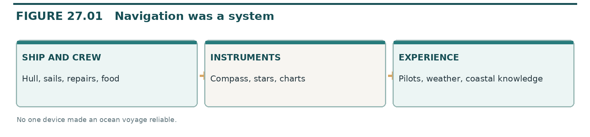

Ocean crossings required ships, sails, rudders, rigging, maps, practical astronomy, accumulated sailing experience and people capable of repairing equipment. Mariners used magnetic compasses, dead reckoning, sounding lines and observations of the Sun or stars. Navigation developed cumulatively from Mediterranean, Atlantic, Islamic and other traditions. Shipbuilding likewise adapted inherited forms: caravels were useful for some exploratory and coastal work, whereas larger naus or carracks carried substantial cargoes on long routes. No single craft or instrument 'made exploration possible' on its own. \[<a href="/027-european-maritime-expansion/sources/#source-5" class="cite">5</a>\]\[<a href="/027-european-maritime-expansion/sources/#source-8" class="cite">8</a>\]\[<a href="/027-european-maritime-expansion/sources/#source-9" class="cite">9</a>\]

A captain with an accurate compass did not automatically know where a ship was. Latitude could sometimes be estimated through astronomical observations; determining longitude accurately remained far more difficult. Dead reckoning used an estimate of direction, speed and elapsed time, with errors accumulating across uncertain currents and weather. Sea charts represented knowledge at a particular moment, not universal truth. A coastline marked confidently could conceal a dangerous sandbank; an empty area of a map could mean little more than a gap in the mapmaker's information. \[<a href="/027-european-maritime-expansion/sources/#source-8" class="cite">8</a>\]\[<a href="/027-european-maritime-expansion/sources/#source-9" class="cite">9</a>\]

Equally important were cooks, carpenters, sailmakers, interpreters, pilots and ordinary sailors. A damaged mast or spoiled water might end a voyage that appeared successful on a globe. An expedition was a logistical and social organization afloat, not simply a celebrated name on a ship's stern. This lesson connects to the military logistics discussed in Chapter 22.

<figure class="figure" id="figure-27-1">

<figcaption>Figure 27.1. No one device made an ocean voyage reliable. <a class="figure-anchor" href="#figure-27-1" aria-label="Link to this figure">#</a></figcaption>
</figure>
