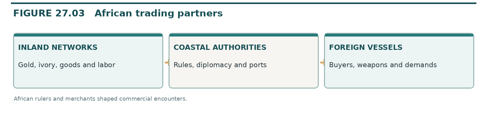

As Portuguese ships sailed farther along the west African coast, they encountered societies with political structures, trading practices and connections reaching inland. Commerce in gold, ivory, pepper, textiles and other goods had long supported African networks, including routes across the Sahara. Portuguese merchants could seek new direct relationships but did not simply take possession of African economic systems. Local rulers regulated access, set terms, used European goods strategically and sometimes rejected foreign requests. \[<a href="/027-european-maritime-expansion/sources/#source-6" class="cite">6</a>\]\[<a href="/027-european-maritime-expansion/sources/#source-12" class="cite">12</a>\]\[<a href="/027-european-maritime-expansion/sources/#source-13" class="cite">13</a>\]

The kingdom of Benin, for example, engaged with Portuguese visitors while its political leadership maintained considerable authority over the terms of exchange. Artistic objects such as carved ivories and metalwork reveal African patronage and skilled craftsmanship alongside changing external connections. In Central Africa, the kingdom of Kongo would develop diplomatic and religious relationships with Portugal, while subsequent tensions exposed the difference between partnership and subordination. These histories should not be compressed into a passive 'African coast.' \[<a href="/027-european-maritime-expansion/sources/#source-12" class="cite">12</a>\]\[<a href="/027-european-maritime-expansion/sources/#source-13" class="cite">13</a>\]\[<a href="/027-european-maritime-expansion/sources/#source-14" class="cite">14</a>\]

Commerce and coercion coexisted. Portuguese raids and purchases of captives contributed to developing systems of Atlantic enslavement, though their character and scale changed over time. Local African actors occupied varied positions as rulers, brokers, captives, resisters and household members. To note African participation in trading networks is not to erase the responsibility of European buyers, shipowners and governments for expanding coercive markets. Conversely, to describe European violence does not require treating African states as incapable of diplomacy or resistance. \[<a href="/027-european-maritime-expansion/sources/#source-15" class="cite">15</a>\]\[<a href="/027-european-maritime-expansion/sources/#source-16" class="cite">16</a>\]

<figure class="figure" id="figure-27-3">

<figcaption>Figure 27.3. African rulers and merchants shaped commercial encounters. <a class="figure-anchor" href="#figure-27-3" aria-label="Link to this figure">#</a></figcaption>
</figure>
