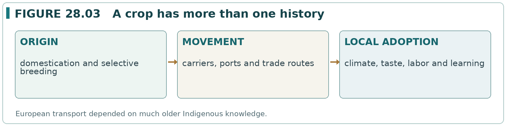

Many staples now considered central to world cuisines originated in the Americas. Maize, potatoes, cassava, sweet potatoes, tomatoes, cacao, chiles, peanuts, several beans and varieties of squash traveled into other regions. Not every variety of bean or squash shared one origin; botanical history is more precise than a shopping list. Their diffusion depended on farmers who understood sowing seasons, soils, seed saving, cooking and the risks of unfamiliar plants.

Why were these crops valuable? Some provided high energy yields in suitable conditions. Others filled ecological niches that local staples did not occupy, or could be harvested at different times of year. In some regions a new crop supplemented wheat or millet; in others it changed the balance of farming. A farmer might prefer maize on a hillside, cassava in soils unsuitable for an existing crop or a sweet potato that offered food during a vulnerable season. No crop, however, guarantees prosperity: harvests can fail, pathogens attack, and land tenure or political violence can block access to food.

A simple geography test reveals the scale of change. Modern Italian tomato dishes, South Asian chili-rich cooking and many African maize meals all arose through centuries of post-1492 adaptation. These cuisines are no less authentically local because a key ingredient once came from elsewhere. Cultural identity develops through choices, recipes and institutions, not just the birthplace of a plant. \[<a href="/028-the-columbian-exchange/sources/#source-2" class="cite">2</a>\]\[<a href="/028-the-columbian-exchange/sources/#source-6" class="cite">6</a>\]

<figure class="figure" id="figure-28-3">

<figcaption>Figure 28.3. European transport depended on much older Indigenous knowledge. <a class="figure-anchor" href="#figure-28-3" aria-label="Link to this figure">#</a></figcaption>
</figure>
