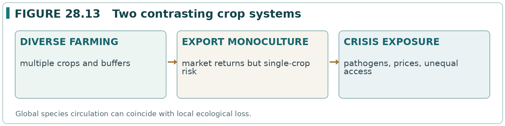

The movement of crops increased the number of potentially cultivable species available in many regions. A farmer in Europe eventually gained access to potato, tomato and maize, while an American settlement gained wheat, cattle and sugarcane. This could enlarge options for calories, flavors and livelihoods. But expansion of large estates and monocultures could simultaneously reduce local diversity.

Consider two hypothetical valleys. Valley A grows several locally adapted crops and adopts small amounts of a new tuber, diversifying its food supply. Valley B clears a mixed landscape to cultivate one export crop, becoming highly dependent on a single market and vulnerable to crop disease. Both participate in the Columbian Exchange; their ecological resilience may move in opposite directions.

The lesson is not that exchange is inherently good or bad. It is that a species' introduction interacts with institutions, population pressures, trade incentives and management practices. Greater <em>global</em> circulation does not necessarily mean greater <em>local</em> biodiversity or equitable access to food.

<figure class="figure" id="figure-28-13">

<figcaption>Figure 28.13. Global species circulation can coincide with local ecological loss. <a class="figure-anchor" href="#figure-28-13" aria-label="Link to this figure">#</a></figcaption>
</figure>
