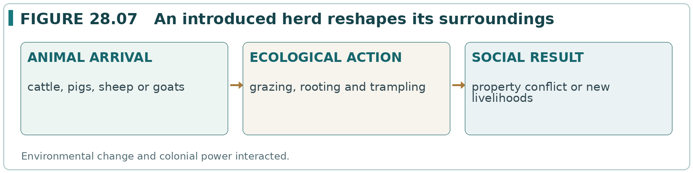

European colonists carried cattle, sheep, pigs and goats to islands and mainlands of the Americas. These animals supplied meat, hides, milk, transport or market value. They also fed on plants, trampled fields and changed vegetation. Pigs could become feral, while grazing animals could compete with existing wildlife and reshape soils and waterways in some landscapes.

The effect of livestock depended on where and how they were raised. A controlled herd on suitable pasture is different from animals multiplying in a vulnerable island ecosystem. Landowners might see abundant cattle as prosperity, while nearby Indigenous farmers could experience crop destruction and loss of access to territory. Animal histories therefore belong to histories of law, property and power. \[<a href="/028-the-columbian-exchange/sources/#source-13" class="cite">13</a>\]

It is inaccurate to say that pre-contact Americans had no domesticated animals. Llamas and alpacas in the Andes, dogs in many regions and turkeys in Mesoamerica are clear counterexamples. What differed was the particular package of large Eurasian grazing and draft animals introduced through colonial settlement. Describing these distinctions precisely is more illuminating than ranking continents as technologically superior or inferior.

<figure class="figure" id="figure-28-7">

<figcaption>Figure 28.7. Environmental change and colonial power interacted. <a class="figure-anchor" href="#figure-28-7" aria-label="Link to this figure">#</a></figcaption>
</figure>
