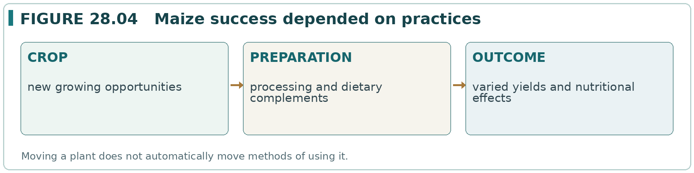

Maize was domesticated in Mesoamerica over many generations, then spread widely within the Americas before European contact. It reached parts of Europe, Africa and Asia through several routes after 1492. In favorable climates it could produce substantial harvests, and people incorporated it into existing fields, rotations and food cultures. Its global success resulted from Indigenous development of the crop combined with the knowledge and labor of later farmers around the world.

In Africa, maize became important in many regions but did not simply replace every indigenous staple. Sorghum, millet, yams and African rice continued to matter. Some communities adopted maize because it ripened quickly or suited particular growing seasons; elsewhere political and economic changes influenced whether it became dominant. Historical research suggests that its effects varied sharply by region and period. Statements that maize alone caused African population growth or conflict are too blunt for the evidence. \[<a href="/028-the-columbian-exchange/sources/#source-7" class="cite">7</a>\]

Nutrition presents another important problem. In many Mesoamerican cultures, maize was processed with alkaline substances in ways commonly described as <em>nixtamalization</em>, improving nutritional availability and other properties. Communities newly adopting maize did not always adopt the same preparation methods. In a diet overwhelmingly dependent on poorly processed maize, nutrient deficiencies could become a public-health problem. The movement of a crop and the movement of knowledge about using it are different historical processes.

<figure class="figure" id="figure-28-4">

<figcaption>Figure 28.4. Moving a plant does not automatically move methods of using it. <a class="figure-anchor" href="#figure-28-4" aria-label="Link to this figure">#</a></figcaption>
</figure>
