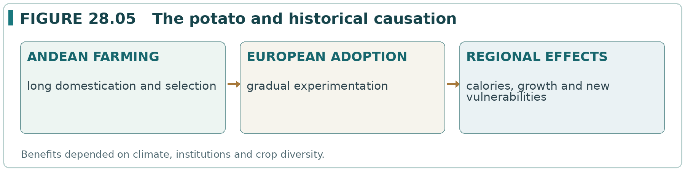

Highland communities in the Andes domesticated and diversified the potato long before Europeans arrived. Farmers selected varieties for altitude, frost tolerance, storage and taste; some developed preservation methods such as freeze-drying into <em>chuño</em>. The potato did not emerge from a single heroic explorer. It was a major Indigenous agricultural achievement carried into a wider world under colonial conditions. \[<a href="/028-the-columbian-exchange/sources/#source-8" class="cite">8</a>\]\[<a href="/028-the-columbian-exchange/sources/#source-9" class="cite">9</a>\]

Potatoes reached Europe in the sixteenth century, but widespread adoption in many places took much longer. A crop unfamiliar to farmers and cooks required new methods, trust, seed supplies and favorable growing conditions. Where it succeeded, the potato offered calories from relatively small areas, supported some growing populations and created alternatives when cereal harvests failed. Economists Nathan Nunn and Nancy Qian found evidence associating the spread of the potato with substantial contributions to Old World population and urbanization in a historical analysis. That is an argument about average long-term effects, not a guarantee that every district benefited equally. \[<a href="/028-the-columbian-exchange/sources/#source-10" class="cite">10</a>\]

The potato also illustrates the danger of narrowing crop diversity. Nineteenth-century Ireland's dependence on vulnerable potato varieties, combined with political and economic conditions, contributed to the catastrophe of the Great Famine after potato blight arrived. This later history does not cancel the potato's earlier benefits. It demonstrates that food security depends on social arrangements, crop diversity and access to resources, not yield alone.

<figure class="figure" id="figure-28-5">

<figcaption>Figure 28.5. Benefits depended on climate, institutions and crop diversity. <a class="figure-anchor" href="#figure-28-5" aria-label="Link to this figure">#</a></figcaption>
</figure>
