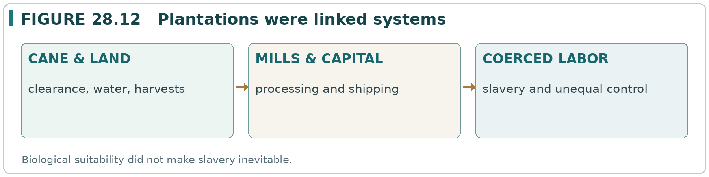

Sugarcane illustrates a chain of changes rather than a single commodity transaction. Cane needs suitable warmth, water and extensive labor for cultivation and processing. A plantation required land, mills, fuel, transport and a workforce compelled or hired under particular regimes. When sugar production expanded in tropical American colonies, it could drive clearing of forests, altered waterways and dependence on export markets.

The exchange of plants consequently changed the movement of capital and people. Demand in European and other markets encouraged investment in mills and shipping; profitable exports stimulated further expansion; the coerced labor force was subjected to brutal exploitation. Plantation production linked biological possibilities to institutions of property, credit and violence.

This raises a useful counterfactual: if sugarcane had not been biologically able to grow in Caribbean environments, the region's economic history might have developed differently. But the existence of suitable climate did not dictate slavery. Institutions, colonial policy, commercial incentives and resistance determined how cultivation was organized. Environment constrains history; it does not write the moral choices of rulers and merchants.

<figure class="figure" id="figure-28-12">

<figcaption>Figure 28.12. Biological suitability did not make slavery inevitable. <a class="figure-anchor" href="#figure-28-12" aria-label="Link to this figure">#</a></figcaption>
</figure>
