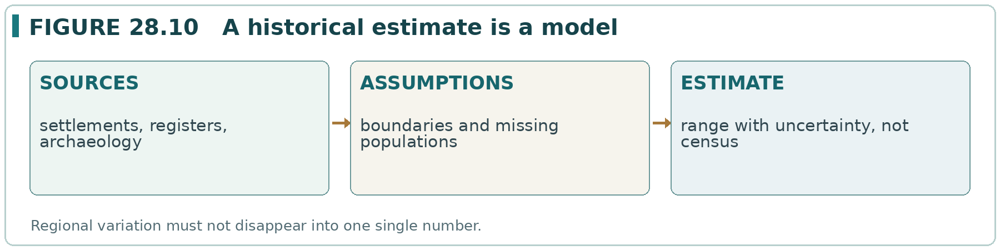

The broad conclusion is secure: many Indigenous societies suffered extraordinary population losses in the century or more after sustained European contact. The precise size of the pre-1492 American population and the total proportion lost remain contested because census data are incomplete and because different regions were contacted at different times. Researchers combine archaeological settlement evidence, later tribute registers, land-use patterns and retrospective demographic models. \[<a href="/028-the-columbian-exchange/sources/#source-18" class="cite">18</a>\]

One influential 2019 synthesis estimated approximately 60.5 million people across the Americas before major post-1492 losses, with a substantial uncertainty interval, and modeled a very large decline over the following century. These are research estimates, not a census. It would be misleading to turn one paper's central value into an unquestioned fact or assume every locality lost the same percentage. Estimates for individual societies and intervals differ, and methods remain debated. \[<a href="/028-the-columbian-exchange/sources/#source-19" class="cite">19</a>\]

A second danger is the narrative of inevitable disappearance. Indigenous Americans did not vanish. Their descendants are present across the hemisphere; communities survived, resisted, integrated new practices and preserved languages and knowledge. Demographic decline is an account of historical violence and disease, not a claim that whole peoples have ceased to exist.

<figure class="figure" id="figure-28-10">

<figcaption>Figure 28.10. Regional variation must not disappear into one single number. <a class="figure-anchor" href="#figure-28-10" aria-label="Link to this figure">#</a></figcaption>
</figure>
