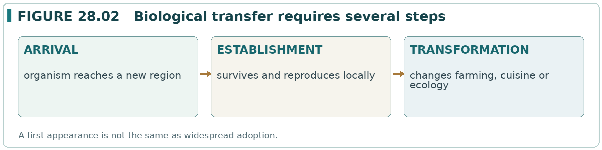

Long geographic separation made the movement of certain organisms particularly consequential. Biological communities had developed different combinations of competitors, predators, pathogens and domesticated animals. When an organism crosses into a new environment, it may encounter suitable soils, fewer familiar enemies or a new set of hosts. But successful establishment is never automatic. Climate, day length, altitude, disease, husbandry and cultural preferences all matter.

The Atlantic was not the only barrier in world history. Before the sixteenth century, Asian and African crops had crossed seas and caravan routes for millennia: sugarcane, citrus, bananas and many other plants had complex migrations. Chapter 26 described Indian Ocean networks, and Chapter 27 described European maritime expansion. The Columbian Exchange did not invent long-distance ecological movement; it connected hemispheres that had seldom participated in the same routine biological circuits.

A helpful distinction is between <em>introduction</em>, <em>establishment</em> and <em>transformation</em>. A tomato seed landing in a garden is an introduction. Repeated cultivation across suitable areas is establishment. Its incorporation into regional cuisines, markets and seed-selection traditions is a transformation. Dates for those phases are not interchangeable, and simplistic diagrams often falsely make them simultaneous.

<figure class="figure" id="figure-28-2">

<figcaption>Figure 28.2. A first appearance is not the same as widespread adoption. <a class="figure-anchor" href="#figure-28-2" aria-label="Link to this figure">#</a></figcaption>
</figure>
