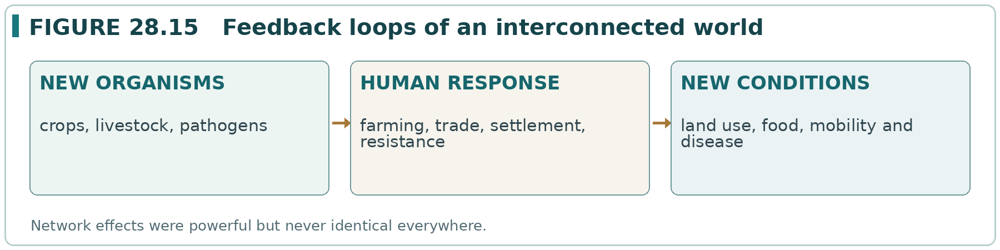

The Columbian Exchange is particularly suited to systems thinking. A new crop can raise food supply in some conditions, supporting population growth. More people might clear additional land and expand trade. Export demand could lead to plantations and forced labor. Land conversion could change habitats and disease exposure, influencing further movement of people. Each element affects others rather than operating in a single straight line.

Feedback loops can be reinforcing or restraining. Successful potato harvests encourage more planting; too much reliance on one susceptible variety increases vulnerability to blight. Cattle numbers rise under favorable conditions; overgrazing degrades the pasture that supports them. New ports attract traders; infections may then spread through the same networks that carry supplies.

This approach makes the phrase 'the exchange changed the world' analytically useful. It asks <em>through which mechanisms, for whom, and under what conditions</em> the change occurred. A historical explanation becomes more powerful when it shows the links rather than listing results.

<figure class="figure" id="figure-28-15">

<figcaption>Figure 28.15. Network effects were powerful but never identical everywhere. <a class="figure-anchor" href="#figure-28-15" aria-label="Link to this figure">#</a></figcaption>
</figure>
